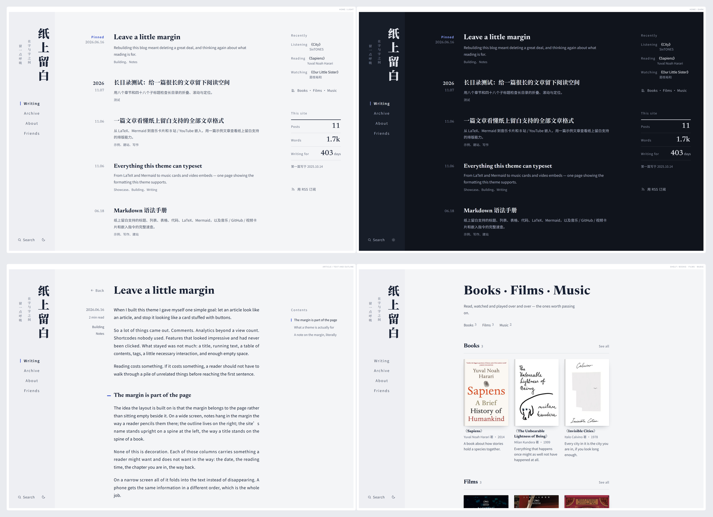
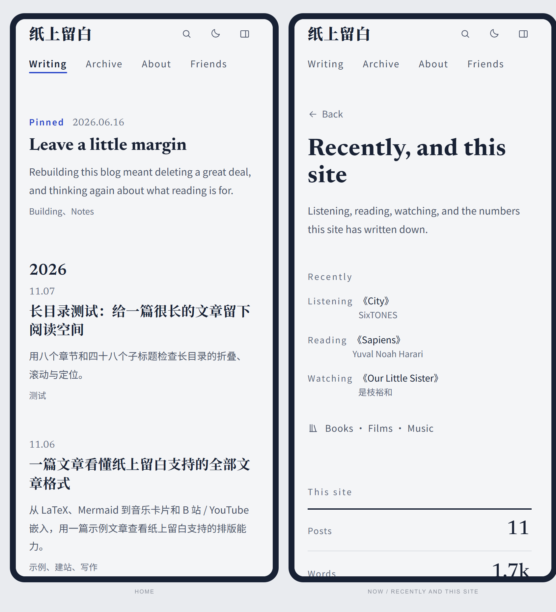
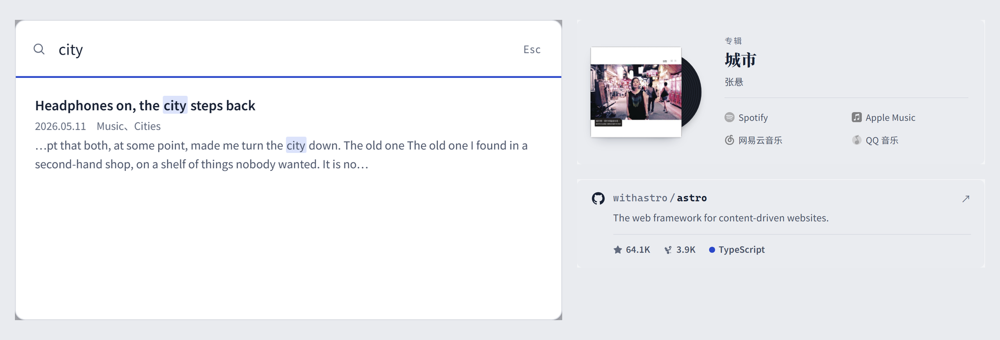
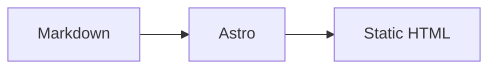

<div align="center">

# OnPaper · 纸上留白

**Leave a little air between the words.**

A Chinese personal blog theme: the margin is part of the page. Reading is organised with a book spine, margin notes and ledger-style lists.

[](LICENSE) [](https://astro.build) [](https://nodejs.org) [](https://pages.cloudflare.com)

[Preview](#preview) · [Features](#features) · [Getting started](#getting-started) · [Shelf](#books--films--music) · [Writing](#writing) · [Markdown](#markdown-extensions) · [Deploy](#deploying-to-cloudflare-pages) · [Design](#design-notes)

**English** · [中文](README.md)

</div>

---

## Preview

The pictures below are generated from the live build rather than assembled by hand: `npm run docs:shots` takes the screenshots, draws the window and phone chrome, and lays out the grid.



<div align="center">



</div>

<div align="center">

<sub><b>Search · Music card · GitHub card</b></sub>

</div>



---

## Features

| | |
| :--- | :--- |
| **✦ Typography first**<br>Noto Sans SC for body and interface; Newsreader + heavy Noto Serif SC for headings, the site name and numerals. Emphasis uses the Chinese emphasis dot (着重号) under each character, not italics. | **◐ Reading**<br>Outline, reading progress, image lightbox, back to top, share bar; copy a citation, generate a share card, print to PDF at the end of a post. |
| **▯ Margin layout**<br>On desktop: a spine at the left, margin notes beside the text, and an outline or aside on wide screens. Narrow screens fold each column back above the text without losing anything. | **◯ Search**<br><kbd>Ctrl</kbd> / <kbd>⌘</kbd> + <kbd>K</kbd> or <kbd>/</kbd> opens it. Titles, tags and body text are indexed at build time, and matches are highlighted. |
| **◑ Theme**<br>Light, dark or follow the system, revealed as a circle from the button and remembered. Cold white paper with blue-black ink; night is a deep blue-black rather than pure black. | **✎ Markdown extensions**<br>KaTeX, Mermaid, music cards (one link, four platforms), GitHub cards, Spotify / Bilibili / YouTube embeds. |
| **▤ Shelf**<br>Books, films and music as three Markdown files, with a poster wall of real Douban covers. Each item has its own page, and items mentioned in a post carry a "wrote about it" link. | **◎ Sharing**<br>Every post gets its own share image at build time (title plus the first 60 characters), and the share card holds a locally generated QR code. |
| **⌘ Accessibility**<br>Skip link, visible focus, semantic headings, `aria-current`, keyboard-operable dialogs, and `prefers-reduced-motion` respected. | **◈ Works in mainland China**<br>All critical CSS and JS ships with the site — no jsDelivr, unpkg or cdnjs — and fonts come only from Google Fonts' China endpoint. |

---

## Getting started

Node.js **22.23.4** or newer (Astro 7's minimum).

```bash
npm install
npm run dev
```

Open <http://127.0.0.1:4321/>.

| Command | What it does |
| --- | --- |
| `npm run dev` | Start the development server |
| `npm run new slug` | Create a post (`title` / `tags` / `pin` / `draft` arguments optional) |
| `npm run build` | Build the static site into `dist/` |
| `npm run build:clean` | Clear the content cache, then build |
| `npm run preview` | Preview the production build (use this to check fonts and animation) |
| `npm run covers` | Fill in shelf and "Recently" fields, and fetch covers |
| `npm run music` | Resolve and cache the links in `::music` cards |
| `npm run og` | Regenerate `public/og.png` from `public/og.svg` |
| `npm run shots` | Playwright screenshot check (run `npm run dev` first) |
| `npm run docs:shots` | Rebuild the pictures in `docs/` from the current build |
| `npm run clean` | Clear only the `.astro` cache |

Tests (each builds first):

| Command | What it verifies |
| --- | --- |
| `npm run test:responsiveness` | Key controls usable under script delay, background prefetch yields, rapid navigation cancels, page-turn overlay |
| `npm run test:performance` | First-screen font weight, no module waiting, no layout shift, search restores |
| `npm run test:hosted-fonts` | Font sources, dynamic glyphs, cross-page reuse, Chrome / WebKit parity |
| `npm run test:font-source` | Font source security boundary, italic collection, display-text collection (no CDN access) |
| `npm run test:theme-controls` | Theme animation, control alignment, search during switching, navigation cleanup |
| `npm run test:render` | Markdown and inline HTML: sanitising, footnotes, KaTeX, Mermaid, shiki |
| `npm run test:i18n` | The two dictionaries match key for key, no empty copy, no Chinese leaking into English |
| `npm run test:shelf` | Shelf and "Recently" parsing, cover fetching, pruning, series directors |
| `npm run test:shelf-keys` | A shelf written with English field names reads the same as one written in Chinese |
| `npm run test:font-gate` | The page stays visible when the font host is unreachable |

### Creating a post

The argument to `npm run new` is the post's **URL**, which is also its filename. The title is derived from it and the date defaults to today:

```bash
npm run new a-walk-without-a-map
```

This writes `src/content/posts/a-walk-without-a-map.md`:

```md
---
title: A Walk Without a Map
description: ''
published: 2026-11-07
tags:
  - _uncategorised
pin: 0
---

Start writing here.
```

To set the title, tags, pin and draft in one go, add `key=value` after the slug — no `--`, no fixed order:

```bash
npm run new a-walk-without-a-map title="A walk without a map" tags=notes,cities pin=1 draft=1
```

| Argument | Meaning |
| --- | --- |
| `title` | The title; defaults to a readable form of the slug |
| `tags` | Comma-separated tags |
| `pin` | Pin weight, default 0 |
| `draft` | `draft=1` saves it as a draft, visible only in development |

A few notes:

- Slugs use lowercase Latin letters, digits and hyphens only
- A non-Latin title goes in `title=...`, never in the slug position
- Without `tags`, a placeholder tag is written; it keeps the frontmatter a list and never appears in posts, tag pages, search or RSS. The placeholder is `_未分类` in a Chinese build and `_uncategorised` in an English one
- An existing file is never overwritten

---

## Project structure

```text
src/
├── config.ts                 Site, nav, palette, fonts, feature flags (single entry point)
├── content.config.ts         Schemas for the posts / pages / shelf collections
├── content/
│   ├── posts/                Posts
│   ├── pages/                about.md, friends.md, now.md (the "Recently" column)
│   └── shelf/                books.md, films.md, music.md
├── i18n/                     Interface copy: zh.ts, en.ts, and the t() helper
├── layouts/BaseLayout.astro  Shell, page-turn animation, theme and font scripts
├── components/               Spine, aside, shelf cards, outline, search, sharing
├── pages/                    Home, archive, post, shelf, recently, 404, RSS, sitemap, OG
├── plugins/                  Markdown directives, Mermaid, links, sanitising, nav bundles, fonts
├── styles/                   base.css (layout and tokens), prose.css, extensions.css
└── utils/                    critical/ inline runtime, post queries, shelf parsing, page-turn handoff

functions/api/views.js        Cloudflare Pages Function (view counter)
scripts/                      Cover fetching, music resolving, OG, screenshots, new post, clean
public/                       favicon, OG, cover cache, _headers, _redirects
tests/                        Regression suites
```

---

## Configuration

Site information, navigation, palette, fonts and feature flags all live in `src/config.ts`. Friends, the shelf and "Recently" are separate Markdown files and are not part of it.

<details>
<summary><b>Show the full config</b></summary>

```ts
export const siteConfig = {
  title: 'OnPaper',
  subtitle: 'Leave a little air between the words.',
  description: 'A personal blog about notes, music and the city at night.',
  author: 'Your Name',
  email: 'hello@example.com',
  url: 'https://example.com', // Change this to your real domain
  lang: 'en',
  locale: 'en_US',
  startYear: 2024,
  postsPerPage: 4,
  tocOpen: false, // The article outline starts collapsed

  i18n: {
    defaultLang: 'en', // 'zh' | 'en' — the language the HTML is built in
  },

  nav: [
    { key: 'home', href: '/' },
    { key: 'tags', href: '/tags/' },
    { key: 'about', href: '/about/' },
    { key: 'friends', href: '/friends/' },
  ],

  socials: [
    { label: 'RSS', href: '/rss.xml', external: true },
    { label: 'GitHub', href: 'https://github.com/', external: true },
    { label: 'Email', href: 'mailto:hello@example.com' },
  ],

  analytics: { googleAnalyticsId: '' },

  theme: {
    defaultMode: 'auto', // auto | light | dark
    light: { paper: '#F4F5F7', ink: '#182134', accent: '#2A47C9', /* … */ },
    dark: { paper: '#10141C', ink: '#E3E6ED', accent: '#93A6FF', /* … */ },
  },

  fonts: {
    display: '"Newsreader", "Noto Serif SC", …',
    body: '"Noto Sans SC", "PingFang SC", …',
    mono: '"SFMono-Regular", Consolas, …',
  },

  features: {
    search: true, views: true, musicCards: true, githubCards: true,
    mediaEmbeds: true, math: true, mermaid: true,
  },
}
```

</details>

### Interface language

Every piece of interface copy lives in `src/i18n/`, as a key-for-key pair of `zh.ts` and `en.ts`. `siteConfig.i18n.defaultLang` decides which one the HTML is built from — change it and the whole interface switches, while the posts themselves are untouched.

The language is settled at build time and there is no switcher on the page. A reader sees the language the site was built in — which is the honest thing for a site that is written in one language, and it keeps the HTML to one copy of each string with no runtime script to swap them.

To publish in both languages, build twice against the two settings and deploy each build to its own site. A component asks for text with `t('search.hint')`, or `<T k="search.hint" />` in markup; the `<html lang>` attribute and `og:locale` follow `defaultLang` as well, so each build declares itself correctly to browsers, screen readers and link previews.

Post language is a separate matter and lives in each post's frontmatter as `lang: en`. The interface language does not filter posts.

### Changing the palette

Change only `theme.light` / `theme.dark`; the theme injects them as CSS variables:

| Variable | Use | Variable | Use |
| --- | --- | --- | --- |
| `paper` | Page background | `ink` | Primary text |
| `paperRaised` | Cards, dialogs | `inkSoft` | Body and secondary text |
| `surface` | One step lighter | `inkFaint` | Dates, margin notes |
| `surfaceAlt` | One step deeper | `line` | Rules and borders |
| `accent` | Links, current position, focus | `accentStrong` | Hover and pressed |
| `accentSoft` | Tinted emphasis | `mark` | Search hit and `<mark>` |
| `selection` | Selection colour | | |

The default is "blue-black ink on cold white paper": `#F4F5F7` paper, `#182134` ink, `#2A47C9` fountain-pen blue. Dark mode uses `#10141C` and a lamp-lit `#93A6FF`, not neutral black.

Sizes, spacing, radii, shadows and motion curves belong to the theme and are defined once in the `:root` block at the top of `src/styles/base.css`, not in the site config.

### Changing the fonts

`siteConfig.fonts` holds three stacks:

- **body**: running text, navigation, interface, search results. Noto Sans SC, one stroke system for CJK and Latin alike
- **display**: the site name, headings, quotations, date numerals. Heavy Noto Serif SC for CJK, Newsreader for Latin and figures
- **mono**: code; maths and Mermaid use their own faces

At build time the font definitions are fetched from `https://fonts.googleapis.cn/css2`, and visitors download WOFF2 from `https://fonts.gstatic.cn`. Every page makes three requests: the shared Newsreader Latin subset, the Noto Sans SC subset for this page's body text, and a Noto Serif SC subset holding only the characters the display face is used for. The build reads which selectors use `var(--font-display)` to collect those characters; where that cannot be determined statically it conservatively treats the whole page as display text rather than guessing at the cascade.

Third-party font CSS goes through the same validation as cached data: only allowlisted descriptors are serialised, only named HTTPS origins are accepted, redirects are not followed, and response size is bounded. The first paint waits for this page's fonts, but shows without them after 6 seconds so an unreachable font host cannot hide the page forever. With JavaScript off, the browser's native loading strategy is used.

---

## Books · Films · Music

Three Markdown files, one list per file:

- `src/content/shelf/books.md`
- `src/content/shelf/films.md`
- `src/content/shelf/music.md`

Each book, film or record is one paragraph, one field per line:

```text
title: My Memories of Old Beijing
author: Lin Haiyin
year: 1960
douban: https://book.douban.com/subject/3057333/
note: I did not understand it as a child; only later did I see it is about goodbye.
```

Every field can be written in English or in Chinese; the theme's own files and everything `npm run covers` writes use the Chinese keys, and both spellings read the same.

| Field | English | Chinese |
| --- | --- | --- |
| Title (required) | `title:` | `书名:` / `片名:` / `名称:` |
| Creator | `author:` / `director:` / `artist:` | `作者:` / `导演:` / `歌手:` |
| Year | `year:` | `年份:` |
| Douban page | `douban:` | `豆瓣:` |
| Player / other link | `link:` | `链接:` |
| Cover | `cover:` | `封面:` |
| One-line note | `note:` | `一句话:` |

The title is required and the rest is optional; `note:` appears under the cover; the `<!-- -->` comment at the top of each file never reaches the page.

A title alone is enough — `npm run covers` fills in the rest (see below).

Pages:

- `/shelf/` — all three walls together
- `/shelf/books/`, `/shelf/films/`, `/shelf/music/` — one list each

Clicking a cover goes to Douban (a record goes back to its music platform; a record's `豆瓣：` line is a note for yourself and is never shown). If an item's title appears in a post, the card grows a "wrote about it" row that jumps to that post, and to the section when there is a matching heading.

Both the combined page and the per-list pages avoid becoming an endless column:

- `/shelf/` shows twelve covers per wall and folds the rest into a `<details>` that needs no script; change `VISIBLE` in `src/pages/shelf.astro`.
- `/shelf/books/` and friends show 25 items per page, with later pages at `/shelf/books/page/2/`; change `SHELF_PER_PAGE` in `src/utils/shelf-covers.ts`.

This is not only about looks: a page that renders a hundred covers makes the browser fetch a hundred images, several megabytes before you reach the bottom. Paging keeps the count fixed however far you scroll.

### Filling in items and covers: `npm run covers`

```bash
npm run covers
```

The script reads the three Markdown files and the "Recently" column (`src/content/pages/now.md`), fills in what each entry is missing, and writes it back. It follows three rules:

1. **Fill, never overwrite.** A field you wrote is left alone. The book says 1960 and Douban says this edition is 2008 — 1960 stays.
2. **Only absent lines are added**, in the order the file's own comment documents. Lines you wrote are kept byte for byte, including the spacing around the colon, and a CRLF file stays CRLF.
3. **If the lookup finds nothing, nothing changes.** The console prints one line, `x 城南旧事: no Douban match`, and the next run tries again.

Books and films go through Douban: an entry's own `豆瓣：` line first, then a search on "title + author/director", accepting only a hit whose title, year and creator agree (a matching title alone is not enough — too many books share one). The mobile subject API then supplies creator, publication year and cover, and `作者` / `导演`, `年份` and `豆瓣` are written in.

Covers are downloaded into `public/shelf/`, recorded in `src/data/shelf-covers.json`, and re-encoded so a poster is 50–110KB.

Music cards keep their covers locally too; see "Music card" below.

Records reuse the music card's resolver (`src/utils/music-resolver.mjs`): a `链接：` line is resolved as written, and an entry without one is looked up on NetEase by name and artist. The result is cached in `src/data/music-cache.json`, `歌手` and `年份` are filled in, `链接：` is pointed at the NetEase album or song page the card should open, and a `豆瓣：` line is recorded for reference — never shown.

An entry that has been completed is skipped on the next run without any network request. To fill only a few:

```bash
node scripts/fetch-covers.mjs 'My Memories of Old Beijing' 'Yi Yi'
```

With arguments it handles only those entries and leaves the "Recently" column alone.

Covers are always stored locally rather than hotlinked: Douban's image hosts reject a browser request without a Douban referrer with a 418; NetEase would serve one, but a local file is the same origin as the page, saves a third-party connection, rides the `immutable` cache header `public/_headers` sets, and cannot break when an image host changes its rules. Static assets and outbound traffic on Cloudflare Pages are free, so extra images cost nothing.

Sizes follow what is actually drawn. A poster is 2:3 in a column at most 222px wide (at a 2560px viewport), so a 2x screen wants about 444px: stored 720px tall (about 505px across, 5–90KB each). A record's cover is square, stored 500px (7–35KB). A 3x screen at 1920px would want 648px, and only a 900px store would satisfy that — larger than what the theme shipped before — so it was not done; serving each density its own file is the real answer and needs `srcset`.

The cover's filename carries its size, so changing `RECIPE` in `scripts/fetch-covers.mjs` and running again produces new files and updates the cache, never leaving an `immutable` reference pointing at an old image.

### Deleting an entry deletes its image

Remove a paragraph from `books.md` / `films.md` / `music.md` and run `npm run covers`, and that entry's cover goes with it: its line is dropped from `src/data/shelf-covers.json`, the file is removed from `public/shelf/`, and the console prints `- 书名: /shelf/xxx.jpg`. Without running the script the image stays — deleting files is the script's job, and the page build never touches them.

What it will not remove:

- A cover you wrote yourself as `封面：/shelf/xxx.jpg` stays as long as its entry does.
- Files not named the way the script names them (twelve hex characters) are never touched, so anything you put in `public/shelf/` by hand is safe.
- If any of the three Markdown files cannot be read, that run removes nothing at all and says so — otherwise one rename would empty the folder.

`npm run music` does the same for `public/music/`: a cover whose `::music{url=...}` no longer appears in any post is removed. The test is the link still written in a post rather than the cache entry, because the cache deliberately keeps deleted links so `npm run covers` can recognise them.

### The "Recently" column

`src/content/pages/now.md` holds three rows. The address at the end of the second line is what the row opens (a Douban subject page for a book or film, a music platform for a record):

```text
Listening：《City》
Deserts Chang https://music.163.com/#/album?id=32312
year：2009
douban：https://music.douban.com/subject/3801228/
```

The first line alone is enough; `npm run covers` fills in the creator, the link and the year the same way it does the shelf. Those extra lines are reference only — the column shows no year and no picture, and the second line's link is the whole of the interaction.

Delete a paragraph and that row disappears. On a phone the column is folded away and the button at the right of the top bar opens `/now/` — a page of its own with a URL and a working back button, not a drawer. Desktop and `/now/` share one `SiteAside.astro`, so a change lands in both.

The counts in "This site" — posts, characters, days — are computed from the posts and need no maintenance.

### Friends

Everything lives in `src/content/pages/friends.md`, three lines per friend (name, URL, description), one blank line between:

```text
A friend's blog
https://example.com/
A short description.
```

Copy a group to add one, delete a group to remove one, reorder groups to reorder the page. The description may be omitted or span several lines.

---

## Writing

`npm run new` is the easiest way, but a plain `.md` in `src/content/posts/` works too — the filename is the URL:

```md
---
title: Rain, and why not to leave yet
description: One sentence that shows up in lists and search.
published: 2026-10-28
updated: 2026-10-30        # optional
tags:
  - Notes
  - Cities
pin: 1                     # 0 is unpinned; higher numbers come first
draft: false               # true hides it outside development
lang: en                   # the post's own language
---

The body…
```

`siteConfig.postsPerPage` sets how many posts the home page shows. Pinned posts appear only on the first page and carry a pin icon in the list. The About page is `src/content/pages/about.md`.

---

## Markdown extensions

### Music card

```md
::music{url="https://open.spotify.com/album/2X2WYTQl5BVInM0StQChCy"}
```

The build reads `src/data/music-cache.json` first and only goes to Spotify when there is no cache entry, then searches Apple Music / NetEase / QQ Music and scores each result on title, artist and type, taking the best above the threshold on each platform. Starting from a Spotify link matches most reliably.

After adding or changing a link, run `npm run music` to write the cache back, and commit it — from then on the build makes no platform requests.

Covers are stored locally too:

```bash
npm run music
```

Each card's cover is downloaded at 600×600, re-encoded to JPEG into `public/music/`, and recorded as `"coverFile": "/music/xxxx.jpg"`, which the card then points at. The filename is a hash of the link and the size, so re-running never piles up copies and changing the size produces a new name (`public/_headers` marks `/music/*` immutable, so a same-name change would be hidden by caches).

Downloads come only from NetEase (`p*.music.126.net`), Spotify (`i.scdn.co`) and Apple (`is*-ssl.mzstatic.com`), and redirects are not followed — the host allowlist is in `src/utils/music-cover.mjs`, with tests. A cover that cannot be fetched records no `coverFile` and the card falls back to the remote image, so the page is never blank.

No cover is downloaded during a build; that happens only in `npm run music`. A link with no `coverFile` yet (you wrote it and have not run the script) shows NetEase's remote image, and running the script once switches it to the local copy.

A manual `::music-card` also accepts a local `cover`, both `/music/xxx.jpg` and `/shelf/xxx.jpg`.

> [!TIP]
> The four platform icons are a fixed 2×2 grid and will not become 3+1 at narrow widths.

Manual form (with your own cover):

```md
::music-card{title="City" artist="Deserts Chang" cover="https://.../cover.jpg" type="album" spotify="https://open.spotify.com/album/..."}
```

### GitHub card

```md
::github{url="https://github.com/withastro/astro"}

::github{repo="withastro/astro" description="…" stars="52k" forks="2.8k" language="TypeScript"}
```

The `url` form resolves owner / repo at build time. In the browser the card reads GitHub's public API on demand and caches in `sessionStorage`; without a network the static fields stay.

### Media embeds

```md
::embed{url="https://open.spotify.com/album/..." title="City — Deserts Chang" caption="Sometimes one album is enough for a night."}
```

YouTube, Bilibili, Spotify and Vimeo are supported. The iframe uses `loading="lazy"`, loads only when it reaches the viewport, and **never autoplays** (Bilibili is given `autoplay=0`, `poster=1` and no autoplay permission).

### Maths and diagrams

Inline `$T = \frac{C}{400}$, block level:

```md
$$
\text{space} = \text{content} - \text{noise}
$$
```

Mermaid:

````md

````

Mermaid is loaded only on pages that contain a diagram; KaTeX's CSS is pulled in only when a post contains maths.

> [!NOTE]
> After changing a Markdown plugin, stop the dev server, run `npm run clean`, then `npm run dev`, so Astro does not keep using a stale content cache.

### Raw HTML in a post

Raw HTML in the body survives, but passes through `rehype-sanitize` (schema in `src/plugins/rehype-sanitize-markdown.mjs`). The sanitizer runs after the author's HTML has been parsed and before the plugins that emit the theme's own markup, so KaTeX's MathML, Mermaid's SVG and the card icons are not re-checked. What is allowed is the theme's own vocabulary (card classes, `data-*`, SVG `viewBox` / `path`); `script` and event attributes are always dropped, and embeds are limited to four allowlisted hosts.

Inline `style` is permitted for typography — a colour, an alignment — but declaration by declaration: only known properties with a value matching that property's shape survive, and `url()`, `expression()`, `position` and the like are dropped individually.

---

## Deploying to Cloudflare Pages

A fully static site; only the view counter uses a Pages Function to reach KV.

| Setting | Value |
| --- | --- |
| Build command | `npm run build` |
| Build output directory | `dist` |
| Node version | 22.23.4+ |

Or build locally and use Wrangler:

```bash
npm run build
npx wrangler pages deploy dist
```

Pages carry Cloudflare's `email_off` markers, so email addresses and `mailto:` stay in the HTML where they are and are not rewritten into script-dependent ones by Email Address Obfuscation.

### Binding KV (optional)

1. **Workers & Pages → KV**, create a namespace, e.g. `onpaper-views`
2. The Pages project → **Settings → Functions → KV namespace bindings**
3. Name the variable **`VIEWS_KV`** and select the namespace
4. Redeploy

Endpoints:

| Method | Path | Behaviour |
| --- | --- | --- |
| `GET` | `/api/views?slug=post-id` | Returns `{ "views": 12 }` |
| `POST` | `/api/views?slug=post-id` | Increments and returns the new value |

Without a KV binding it answers 503, the post page hides the counter, and reading is unaffected. `npm run dev` serves an in-memory equivalent that resets on restart.

### Security headers

CSP, HSTS, `X-Frame-Options`, `Permissions-Policy` and long-lived static caching are written in `public/_headers`. `_astro`, `fonts`, `_navigation`, `shelf`, `og` and `images` are all `immutable`.

> Astro's own `security.csp` was tried and blocks the inline styles Shiki emits, so hand-written static headers are used instead.

### Sitemap and 404

The build produces `sitemap-index.xml` plus an identical `sitemap.xml`, with post entries carrying `lastmod` (`updated`, else `published`). `robots.txt` points at the index.

404 is `src/pages/404.astro`, built to `dist/404.html`, which Cloudflare Pages serves for unknown paths automatically. `/page/1/` is 301'd home by `public/_redirects`, with a script-free redirect page so local preview works too.

> [!IMPORTANT]
> Before going live, change `url` in `src/config.ts` to your real domain. Otherwise the sitemap, robots.txt, canonical URLs, RSS and share images all point at the example domain.

### Share images (OG)

- `public/og.svg` is the default template; `npm run og` renders it to `public/og.png` (1200×630)
- Each post gets its own `/og/<slug>.png` at build time: the site name upright on the left, the date, title and first 60 characters on the right. Fonts are subset to the characters the image uses and cached in `node_modules/.cache/onpaper-og/`
- A post's share card carries a QR code that opens that post, generated in the browser with `uqr` — no external service

### Google Analytics 4 (optional)

1. Create a property and a web data stream in [Google Analytics](https://analytics.google.com) and copy the `G-XXXXXXXXXX` ID
2. Put it in `siteConfig.analytics.googleAnalyticsId`
3. Rebuild and deploy

`gtag.js` is injected only in a production build with a non-empty ID; `npm run dev` never loads it. Automatic page_views are off, and `page_view` is reported on `astro:page-load` so client-side navigation is counted too. Left empty, GA is not loaded at all.

---

## Design notes

The whole theme rests on one idea: **the margin is part of the page.**

- **Spine**: a narrow column at the left on desktop, the site name standing upright like a title on a book's spine, with the subtitle, navigation and search / theme buttons below. Tablet and phone turn it into a top bar that yields as you read down and returns as soon as you scroll up.
- **Margin notes**: the grid is "margin column · text column · right column". The date, year, reading time and tags sit to the left of the text like pencil notes in a book, and fold above it on a narrow screen.
- **Home**: the site's introduction breaks into one line per sentence as an opening; the post list reads like a ledger, writing the year only where it changes; pinned posts are larger and carry the full date.
- **Right column**: a short ledger — three rows of "Recently", the site's counts, and links to the shelf and RSS. There is little of it, so it is given room to breathe. On a phone, `/now/` shows the same content.
- **Article**: nothing decorates the space between title and text; margin notes stay beside the line you are reading; a wide screen puts the outline on the right, a narrower one folds it above the text.
- **Shelf**: a wall of covers. A real cover is decoration enough, so there is no border, no shadow and no caption — only title, creator and year underneath.
- **Archive**: the year in large type in the margin, tags laid out like an index at the back of a book, counts set as superscripts.
- **Friends**: an address book, one line per friend, not a grid of cards.
- **Type**: sans-serif for body text, a heavy serif for headings and quotations — following the Chinese book convention of changing face for a quotation instead of drawing a box around it.
- **Icons**: all inline SVG; no third-party icon library.

### Motion

Only `transform`, `opacity` and `clip-path` are animated, and `prefers-reduced-motion` is handled per component.

- **Page turn**: a sheet the colour of the paper wipes across (200ms), the content is swapped while it covers the page, and then it lifts away. The router waits for the sheet, so the next page never flashes into view first.
- **Outline**: expanding animates the list's own height, and the text never disappears or redraws, so the row under the pointer is not scrolled away.
- **First paint**: the site name is "inked" character by character, once per session. The characters themselves are never animated — text that enters a compositing layer is antialiased differently, which reads as a twitch.
- **Other**: the short line marking the current nav item slides to its new place on navigation; the lightbox grows from the image's position and returns; the theme switch reveals as a circle from the button; copying code confirms on the button itself.

### Performance

- Critical interactions (theme, search, outline, mobile bar, back to top, the inked wordmark) are compiled to inline script at build time and placed after the finished body and before the font gate, so the first visible paint waits for no external module.
- Navigation inside the site does not reload the page: each page is exported at build time as a navigation bundle under `/_navigation/<hash>/<route>.json` holding only markup and `src` modules, fetched on demand.
- Background prefetch runs at most two at a time and covers at most two links; a real click cancels outstanding prefetch, the next page's fonts load at high priority, and navigating again cancels stale downloads.

---

## Inspiration

The layout owes a debt to two Astro themes:

- [astro-theme-retypeset](https://github.com/radishzzz/astro-theme-retypeset)
- [astro-theme-typography](https://github.com/moeyua/astro-theme-typography)

---

## Licence

[MIT](LICENSE) · Newsreader, Noto Serif SC and Noto Sans SC are used under the SIL Open Font License 1.1; the licence files are in `public/fonts/`.

<sub>*OnPaper · leave a little air between the words.*</sub>
