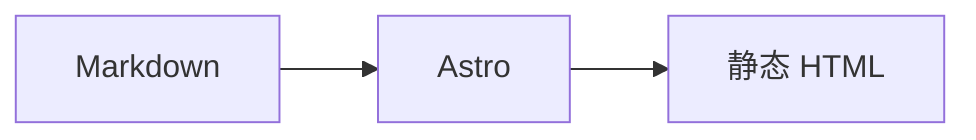

# 余白 / Yohaku

一个为中文个人博客写的 Astro 主题。借鉴 Claude / Anthropic 官网的配色与字体气质，页面布局则回到传统博客：正文列 + 右侧窄栏、文章列表、时间线归档、文章直接铺在纸面上。

视觉上参考 Claude / Anthropic 的暖色语言（奶油纸色、墨色、赤陶橙、橄榄绿），组件、代码和素材都是为这个主题重新实现的，不是任何现有主题的换皮。

- Astro 7，纯静态输出，适配 Cloudflare Pages
- 无前端框架，零客户端 UI 运行时
- 中文单语（README 末尾说明以后如何扩展）
- 浅色 / 深色 / 跟随系统
- 首页、文章、归档时间线、标签、关于、404、分页
- 全文搜索（Ctrl / Cmd + K，或按 `/`）
- 音乐卡片：Spotify / Apple Music / 网易云 / QQ 音乐自动识别、跨平台匹配、构建期缓存，沿用原版卡片结构
- 友链页
- 可选 Google Analytics 4（含 Astro 客户端路由的 page_view 处理）
- 1200×630 分享卡片（Open Graph），可用 `npm run og` 重新生成
- 页面淡入转场、搜索弹窗淡入与背景虚化、按钮按压的柔和透明度反馈、卡片 hover 色温变化和滚动渐入，尊重 `prefers-reduced-motion`
- 文章“返回”会回到来源列表页并恢复滚动位置（首页分页、标签页等）；直接打开文章时回首页
- 文章页移动端顶栏随滚动压缩，给正文让出阅读空间
- 全站中文统一为 Noto Serif SC，英文统一为 Newsreader；代码、数学和图表保留专用字体
- 浅色目录面板（列表图标 + 折叠开关），展开后随滚动标记当前章节；正文图片点击放大，支持滚轮 / 双指缩放和拖动
- 9 篇中文示例文章，含长标题、长正文、两张本地示例图和跨年份归档
- Markdown 扩展：KaTeX、Mermaid、GitHub 卡片、媒体嵌入
- 阅读进度、回到顶部、分享（原版 SVG 图标）、可选阅读计数（Cloudflare KV）
- RSS、sitemap、robots、Open Graph
- 键盘焦点、跳转正文、减少动效、44px 触控热区

## 快速开始

需要 Node.js 22.12 或更高版本。

```bash
npm install
npm run dev
```

打开 `http://127.0.0.1:4321/`。上线前审计、性能与安全结论见 **`AUDIT.md`**。

```bash
npm run build      # 生成静态站点到 dist/
npm run build:clean # 清理 Astro 内容缓存后再构建（改过 remark/rehype 插件时用）
npm run preview    # 预览构建结果
npm run shots      # Playwright 截图检查（需要先运行 dev）
npm run og         # 重新生成 public/og.png 分享图
npm run music      # 重新解析并缓存 ::music 指令里的链接
```

## 站点配置

所有站点信息都在 `src/config.ts`：

```ts
export const siteConfig = {
  title: '余白',
  subtitle: '在字与字之间，留一点呼吸。',
  description: '……',
  author: '林间',
  url: 'https://yohaku.example.com',
  postsPerPage: 4,
  tocOpen: false, // 文章目录默认收起
  nav: [
    { label: '文章', href: '/' },
    { label: '归档', href: '/tags/' },
    { label: '关于', href: '/about/' },
    { label: '友链', href: '/friends/' },
  ],
  friends: [
    { name: '山茶书房', url: 'https://shanchafang.example/', description: '……' },
  ],
  analytics: {
    googleAnalyticsId: '', // 可选，填写 GA4 的 G-XXXXXXXXXX
  },
  socials: [
    { label: 'RSS', href: '/rss.xml', external: true },
    { label: 'GitHub', href: 'https://github.com/', external: true },
    { label: 'Email', href: 'mailto:hello@yohaku.example' },
  ],
  theme: {
    defaultMode: 'auto', // auto | light | dark
    light: { paper: '#FAF9F5', ink: '#141413', accent: '#D97757', /* ... */ },
    dark: { paper: '#141413', ink: '#FAF9F5', accent: '#D97757', /* ... */ },
  },
  fonts: {
    display: '"Newsreader", "Noto Serif SC Variable", "Songti SC", ...',
    body: '"Newsreader", "Noto Serif SC Variable", "Songti SC", ...',
    mono: '"SFMono-Regular", Consolas, ...',
  },
  features: {
    search: true,
    views: true,
    musicCards: true,
    githubCards: true,
    mediaEmbeds: true,
    math: true,
    mermaid: true,
  },
}
```

### 改配色

只改 `theme.light` / `theme.dark` 里的颜色即可。主题会把它们注入成 CSS 变量：

| 变量 | 用途 |
| --- | --- |
| `paper` | 页面背景 |
| `paperRaised` | 卡片 / 代码块表面 |
| `surface` | 浅一层的表面 |
| `surfaceAlt` | 更深的表面 |
| `ink` | 主文字 |
| `inkSoft` | 正文 / 次要文字 |
| `inkFaint` | 日期 / 说明文字 |
| `line` | 分隔线 |
| `accent` | 链接、当前导航、强调 |
| `accentStrong` | 强调文字的深色版本 |
| `accentSoft` | 强调的浅底 |
| `peach` | 辅助暖色 |
| `moss` | 辅助橄榄绿 |

默认配色取的是 Claude / Anthropic 官网的暖色系：`#FAF9F5`、`#141413`、`#D97757`、`#788C5D`。

### 改字体

`siteConfig.fonts` 控制三套字体栈。全站中文统一使用自托管的 **Noto Serif SC Variable**（按 `unicode-range` 分片，浏览器只加载页面实际用到的字形），英文使用自托管的 **Newsreader**（SIL OFL）；代码块使用等宽字体，数学和 Mermaid 使用各自的专用字体。

Noto Serif SC 使用 `font-display: optional`：首次冷加载如果字体子集还没到齐，会先用系统宋体显示，字体缓存后统一为 Noto，避免字体切换时文字跳动。中文子集首次加载约 1.1–1.4MB，之后走浏览器缓存。

### 友链

在 `siteConfig.friends` 里增删条目，每项包含 `name`、`url`、`description`。友链页会自动生成，导航里的“友链”入口也来自 `siteConfig.nav`。

### Google Analytics 4（可选）

1. 在 [Google Analytics](https://analytics.google.com) 创建媒体资源和 Web 数据流，复制 Measurement ID（`G-XXXXXXXXXX`）。
2. 填到 `siteConfig.analytics.googleAnalyticsId`。
3. 重新执行 `npm run build` 并部署。

只有生产构建且 ID 非空时才会注入 `gtag.js`；`npm run dev` 不会加载。`npm run preview` 预览的是生产构建，因此会加载。主题关闭了 GA 的自动 page_view，改为在 Astro 的 `astro:page-load` 事件里手动上报，客户端路由切换也能正确统计。留空则完全不加载任何 GA 脚本。

### 分享图（OG）

`public/og.svg` 是分享卡片模板，`npm run og` 会把它渲染成 `public/og.png`（1200×630）。页面默认用这张图作为 `og:image` / `twitter:image`，Telegram、X、微信等平台会读取它作为链接缩略图。修改标题、副标题或配色后，先同步更新 `public/og.svg`，再重新运行 `npm run og`。

## 写文章

在 `src/content/posts/` 新建 `.md` 文件：

```md
---
title: 雨停之前，先别急着走
description: 一句话摘要，会出现在列表和搜索里。
published: 2026-10-28
updated: 2026-10-30        # 可选
tags:
  - 随笔
  - 城市
pin: 1                     # 0 为不置顶，数字越大越靠前
draft: false               # true 时只在 dev 可见
---

正文……
```

关于页在 `src/content/pages/about.md`。首页每页文章数由 `siteConfig.postsPerPage` 控制，置顶文章只出现在第一页，列表里用一个小别针图标标记，不显示“置顶”文字。

## Markdown 扩展

### 音乐卡片

自动解析（推荐）：

```md
::music{url="https://open.spotify.com/album/2X2WYTQl5BVInM0StQChCy"}
```

构建时会：

1. 读取 `src/data/music-cache.json` 的缓存；
2. 没有缓存时，调用对应平台接口获取标题、艺人、封面和类型；
3. 在 Apple Music / 网易云 / QQ 音乐中搜索同一张专辑或同一首歌；
4. 生成带各平台链接的音乐卡片。

为了不让每次构建都请求平台，新增或修改链接后运行：

```bash
npm run music
```

它会把解析结果写回 `src/data/music-cache.json`，建议一起提交。

手动填写（需要自己准备封面）：

```md
::music-card{title="城市" artist="张悬" cover="https://.../cover.jpg" type="album" spotify="https://open.spotify.com/album/..."}
```

音乐卡片、自动解析、跨平台匹配和平台 SVG 图标沿用作者原有博客的实现。自动卡片只显示类型、标题、艺人和平台链接，不显示歌词或额外文案；手动 `music-card` 仍可选填 `lyric`。桌面是紧凑横向卡片（118px 封面）；移动端改为垂直卡片：140px 封面居中，类型/标题/艺人居中，平台链接固定两行两列（4 个平台，内容块居中、图标按列对齐），卡片最大 360px，标题使用站点衬线字体。

### GitHub 卡片

```md
::github{repo="withastro/astro" description="The web framework for content-driven websites." stars="52k" forks="2.8k" language="TypeScript"}
```

卡片在浏览器里按需读取 GitHub 公开 API，并用 `sessionStorage` 缓存。没有网络时会保留下面的静态字段。

### 媒体嵌入

```md
::embed{url="https://open.spotify.com/album/2X2WYTQl5BVInM0StQChCy" title="张悬《城市》" caption="有时候，一张专辑就够陪一个晚上。"}
```

支持 YouTube、Bilibili、Spotify、Vimeo。默认显示点击播放的海报，用户点击后才创建 iframe，避免首屏加载第三方资源。

### 数学与图表

行内数学：`$T = \frac{C}{400}$`；块级数学：

```md
$$
\text{余白} = \text{内容} - \text{噪音}
$$
```

Mermaid：

````md

````

Mermaid 只在页面出现图表时才动态加载。KaTeX 的 CSS 也只在文章包含数学时引入。

## Cloudflare Pages 部署

站点是纯静态的；只有阅读计数通过一个 Pages Function 访问 KV。

### 1. 构建

在 Cloudflare Pages 里设置：

- Build command: `npm run build`
- Build output directory: `dist`
- Node version: 22.12+

或者本地构建后用 Wrangler 上传：

```bash
npm run build
npx wrangler pages deploy dist
```

### 2. 绑定 KV（可选，用于阅读计数）

在 Cloudflare 控制台：

1. 进入 **Workers & Pages → KV**，创建一个命名空间，例如 `yohaku-views`。
2. 进入 Pages 项目 → **Settings → Functions → KV namespace bindings**。
3. 变量名填 **`VIEWS_KV`**，选择刚创建的命名空间。
4. 重新部署。

也可以使用 Wrangler：

```bash
npx wrangler kv namespace create VIEWS_KV
```

把返回的 id 填进 `wrangler.toml` 里被注释掉的 `[[kv_namespaces]]` 块并取消注释。`functions/api/views.js` 会被 Pages 自动识别为 `/api/views`。如果不使用 Wrangler 绑定，直接在 Pages 控制台绑定 `VIEWS_KV` 也可以。

接口：

- `GET /api/views?slug=post-id` → `{ "views": 12 }`
- `POST /api/views?slug=post-id` → 计数 +1，返回新值
- 只接受 `[A-Za-z0-9_-]`、最长 100 字符的 slug
- KV 未绑定时返回 503，文章页会自动隐藏计数，不影响阅读

`npm run dev` 使用内存里的同名接口做演示；重启开发服务器后计数会归零。

## 目录

```
src/
  config.ts                 站点、导航、配色、字体、功能开关
  content.config.ts         内容集合 schema
  content/
    posts/                  文章
    pages/about.md          关于页
  components/               界面组件
  layouts/BaseLayout.astro  页面外壳、主题脚本、全局样式
  pages/                    首页、文章、归档、标签、关于、搜索索引、RSS
  plugins/                  Markdown 指令、Mermaid、外链、开发期 views
  styles/                   字体、布局、正文、扩展卡片
  utils/                    文章查询、格式化、音乐解析
functions/api/views.js      Cloudflare Pages Function
scripts/                    音乐缓存、截图
public/                     favicon、OG、字体、_headers
```

## 设计说明

- 布局：正文列 + 右侧固定窄栏（刊头、导航、搜索、主题、页脚）；移动端折叠为顶部导航和单列文章列表。
- 刊头：右栏只保留大号「余白」和副标题，去掉卷号与英文小字，减少视觉噪音。
- 首页：文章列表 + 分页，不做营销式 hero 或卡片网格；列表标题、描述和分隔线与内容列同宽。
- 文章页：宽屏桌面左侧固定层级目录；窄桌面/平板回退到顶部目录面板；移动端只看顶部目录，不显示返回首页按钮。标题左侧的「← 首页」在桌面固定悬浮，阅读时始终可见；右下角 Top 已移到左下。正文图片可点击放大；分享栏使用原项目的 SVG 图标。
- 归档：按年份分组的纵向时间线 + 标签索引；关于页直接使用正文排版。
- 字体：Newsreader（拉丁标题）+ Noto Serif SC Variable（中文标题）+ 系统无衬线（正文）；日期使用 Newsreader 斜体。
- 颜色：奶油纸色、墨色、赤陶橙、橄榄绿；平涂背景，没有渐变和装饰光效；导航当前项使用平涂赤陶色记号。
- 动效：轻量页面过渡、悬停颜色、滚动渐入、主题切换从按钮位置展开的圆形揭示；动画优先使用透明度和 transform，顶栏压缩只改动自身高度与字号且不使用实时模糊，全部尊重 `prefers-reduced-motion`。没有做标题跨页缩放，避免标题突然放大和掉帧。
- 图标：全部为内联 SVG 或 CSS 形状，不使用 emoji 当图标。
- 可访问性：跳转正文、可见焦点、44px 触控热区、语义化标题、`aria-current`、可键盘操作的搜索弹窗；小字与链接的对比度按 4.5:1 调整。

## 已知取舍

- 只做中文单语。要加语言，可参考 Astro 的 i18n 路由，把 `src/content` 按语言分目录，并在 `siteConfig` 里加语言列表；当前没有内置语言切换。
- 没有评论系统。评论需要后端与反垃圾策略，不适合作为静态主题的默认依赖。
- 音乐解析依赖第三方平台接口，可能因平台改版失效；缓存能保证已有文章正常构建。封面来自平台元数据，版权归原平台 / 唱片公司所有。
- Mermaid 和 GitHub 卡片是渐进增强：没有 JavaScript 时，Mermaid 会显示源码，GitHub 卡片仍可点击。

## 安全

- 完整审计、威胁模型和残余风险见 **`SECURITY.md`**。
- `npm audit` 当前为 0；KaTeX 通过 `overrides` 统一到 0.19.1。
- 生产响应头与 CSP 在 `public/_headers`；Cloudflare Function 在 `functions/api/views.js`。
- CSP 仍保留 `'unsafe-inline'`（Astro 内联脚本/样式所需），但加了 `script-src-attr 'none'`；要更严格可改用 nonce/hash。
- 建议在 Cloudflare WAF 给 `/api/views` 的 POST 加限流；Markdown 按“可信作者内容”处理，不要直接合并不受信任的投稿。

## 许可

MIT。字体 Newsreader 与 Noto Serif SC 使用 SIL Open Font License 1.1，见 `public/fonts/OFL-Newsreader.txt` 和 `public/fonts/OFL-NotoSerifSC.txt`。

音乐解析器与缓存流程改编自作者原有博客，已获得作者许可。