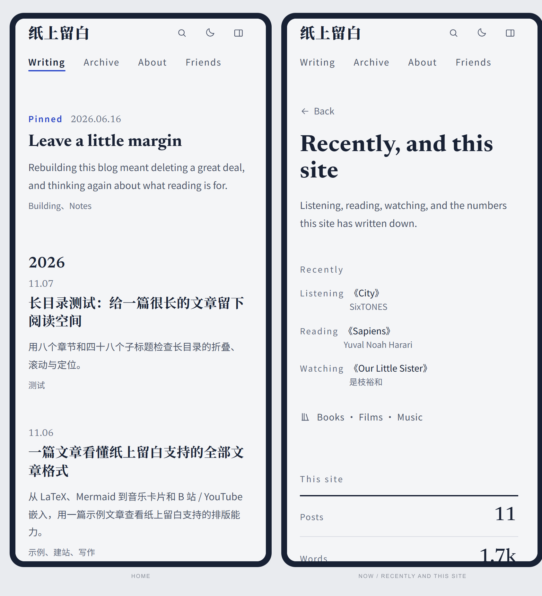
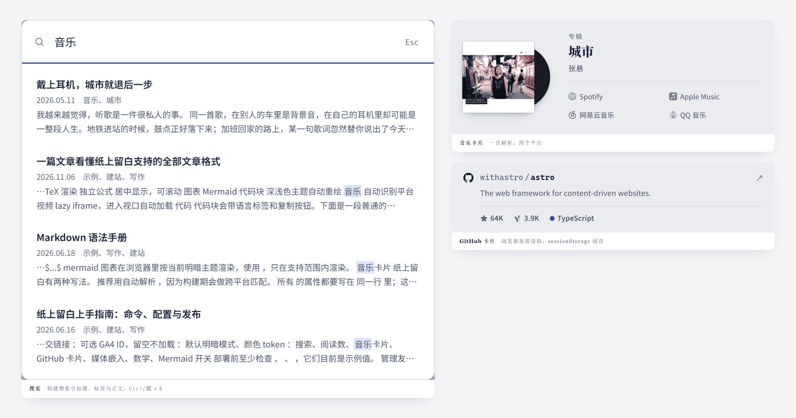
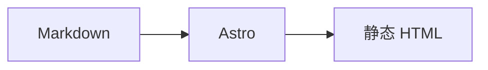

<div align="center">

# 纸上留白 · OnPaper

**在字与字之间，留一点呼吸。**

一个中文个人博客主题：把页边当作页面的一部分，用书脊、页边注和账本式的列表来组织阅读。

[](LICENSE) [](https://astro.build) [](https://nodejs.org) [](https://pages.cloudflare.com)

[预览](#预览) · [特性](#特性) · [快速开始](#快速开始) · [书单](#书单--片单--歌单) · [写文章](#写文章) · [Markdown](#markdown-扩展) · [部署](#部署到-cloudflare-pages) · [设计](#设计说明)

**中文** · [English](README.en.md)

</div>

---

## 预览


<div align="center">



</div>

<div align="center">

<sub><b>搜索 · 音乐卡片 · GitHub 卡片</b></sub>

</div>



---

## 特性

| | |
| :--- | :--- |
| **✦ 排版优先**<br>正文与界面 Noto Sans SC，标题、站名与数字 Newsreader + Noto Serif SC 粗字重。强调用中文着重号，不是斜体。 | **◐ 阅读体验**<br>目录、阅读进度、图片灯箱、回到顶部、分享栏；文末可复制引用、生成分享卡片、打印成 PDF。 |
| **▯ 页边布局**<br>桌面端左侧书脊、正文左侧页边注、宽屏右侧目录或右栏；窄屏一路折回正文上方，不丢信息。 | **◯ 搜索**<br><kbd>Ctrl</kbd> / <kbd>⌘</kbd> + <kbd>K</kbd> 或 <kbd>/</kbd> 唤起；构建期索引标题、标签与正文，命中处高亮。 |
| **◑ 主题**<br>浅色 / 深色 / 跟随系统，从按钮处圆形揭示，可持久化。冷白纸面 + 蓝黑墨水，夜间是深蓝墨底而非纯黑。 | **✎ Markdown 扩展**<br>KaTeX、Mermaid、音乐卡片（一链四平台）、GitHub 卡片、Spotify / B 站 / YouTube 嵌入。 |
| **▤ 书架**<br>书单、片单、歌单三份 Markdown，海报墙来自豆瓣真实封面，点进去是条目页，写过文章的条目还挂着「写过」链接。 | **◎ 分享**<br>每篇文章构建时生成自己的分享图（标题 + 摘要前 60 字），分享卡片带本地生成的二维码。 |
| **⌘ 无障碍**<br>跳转正文、可见焦点、语义化标题、`aria-current`，弹窗可键盘操作，尊重 `prefers-reduced-motion`。 | **◈ 中国大陆可用**<br>核心 CSS / JS 全部随站打包，不依赖 jsDelivr、unpkg、cdnjs；字体只走 Google Fonts 中国接口。 |

---

## 快速开始

需要 Node.js **22.23.4** 或更高版本（Astro 7 的最低要求）。

```bash
npm install
npm run dev
```

打开 <http://127.0.0.1:4321/>。

| 命令 | 说明 |
| --- | --- |
| `npm run dev` | 启动开发服务器 |
| `npm run new 网址` | 新建文章（可带 `title` / `tags` / `pin` / `draft` 参数） |
| `npm run build` | 生成静态站点到 `dist/` |
| `npm run build:clean` | 清理内容缓存后再构建 |
| `npm run preview` | 预览生产构建（比较字体与动画请用它） |
| `npm run covers` | 补全书单 / 片单 / 歌单 / 「最近」的字段与封面 |
| `npm run music` | 解析并缓存 `::music` 里的链接 |
| `npm run og` | 从 `public/og.svg` 重新生成 `public/og.png` |
| `npm run shots` | Playwright 截图检查（需先 `npm run dev`） |
| `npm run clean` | 只清理 `.astro` 缓存 |

测试（每条都会先构建）：

| 命令 | 验证内容 |
| --- | --- |
| `npm run test:responsiveness` | 脚本延迟下关键控件可用、后台预取让路、连续换页取消、翻页遮罩 |
| `npm run test:performance` | 首屏字体体积、无模块等待、无布局跳动、搜索恢复 |
| `npm run test:hosted-fonts` | 在线字体来源、动态字形、跨页复用、Chrome / WebKit 一致性 |
| `npm run test:font-source` | 字体源安全边界、斜体收集、显示字体文字收集（不访问 CDN） |
| `npm run test:theme-controls` | 主题动画、控件对齐、切换中搜索、换页清理 |
| `npm run test:render` | Markdown 与行内 HTML：消毒、脚注、KaTeX、Mermaid、代码高亮 |
| `npm run test:i18n` | 中英字典键一一对应、无空文案、英文里不漏中文 |
| `npm run test:shelf` | 书单 / 片单 / 歌单与「最近」的解析、封面抓取与清理、剧集导演 |

### 新建文章

`npm run new` 后面跟的是**文章的网址**，也就是文件名。标题默认由网址生成，日期自动填今天：

```bash
npm run new a-walk-without-a-map
```

生成 `src/content/posts/a-walk-without-a-map.md`：

```md
---
title: A Walk Without a Map
description: ''
published: 2026-11-07
tags:
  - _未分类
pin: 0
---

在这里开始写正文。
```

想一次把标题、标签、置顶和草稿都定好，就在网址后面写 `key=value`（不需要 `--`，也不用记位置）：

```bash
npm run new a-walk-without-a-map title=在一条不认识的街上走一会儿 tags=随笔,城市 pin=1 draft=1
```

| 参数 | 说明 |
| --- | --- |
| `title` | 标题，默认把网址变成可读标题 |
| `tags` | 标签，逗号分隔，中英文逗号都行 |
| `pin` | 置顶权重，默认 0 |
| `draft` | 写 `draft=1` 存为草稿，只在开发环境可见 |

几个要点：

- 网址只用小写英文、数字和连字符
- 中文标题写成 `title=...`，不要把中文直接放网址位置
- 不写 `tags` 时会填占位标签 `_未分类`，它只维持 frontmatter 的列表格式，不会出现在文章、标签页、搜索或 RSS 里
- 同名文件已存在会拒绝覆盖

---

## 项目结构

```text
src/
├── config.ts                 站点、导航、配色、字体、功能开关（单一配置入口）
├── content.config.ts         posts / pages / shelf 三个集合的 schema
├── content/
│   ├── posts/                文章
│   ├── pages/                about.md、friends.md、now.md（右栏「最近」）
│   └── shelf/                books.md、films.md、music.md
├── layouts/BaseLayout.astro  页面外壳、翻页动画、主题与字体脚本
├── components/               书脊、右栏、书架卡片、目录、搜索、分享等
├── pages/                    首页、归档、文章、书架、最近、404、RSS、sitemap、OG
├── plugins/                  Markdown 指令、Mermaid、外链、消毒、导航包、字体
├── styles/                   base.css（布局与令牌）、prose.css、extensions.css
└── utils/                    critical/ 内联运行时、文章查询、书架解析、翻页交接

functions/api/views.js        Cloudflare Pages Function（阅读计数）
scripts/                      封面抓取、音乐解析、OG、截图、新建文章、清理
public/                       favicon、OG、封面缓存、_headers、_redirects
tests/                        五套回归测试
```

---

## 配置

站点信息、导航、配色、字体和功能开关都集中在 `src/config.ts`。友链、书单、「最近」各自是 Markdown，不在这个文件里。

<details>
<summary><b>展开完整配置</b></summary>

```ts
export const siteConfig = {
  title: '纸上留白',
  subtitle: '在字与字之间，留一点呼吸。',
  description: '一个关于随笔、音乐与城市夜色的个人博客。',
  author: '李凡凡',
  email: 'hello@onpaper.example',
  url: 'https://onpaper.example.com', // 部署后改成真实域名
  lang: 'zh-CN',
  locale: 'zh_CN',
  startYear: 2024,
  postsPerPage: 4,
  tocOpen: false, // 文章目录默认收起

  i18n: {
    defaultLang: 'zh', // 'zh' | 'en'，构建时决定界面用哪种语言
  },

  nav: [
    { label: '文章', href: '/' },
    { label: '归档', href: '/tags/' },
    { label: '关于', href: '/about/' },
    { label: '友链', href: '/friends/' },
  ],

  socials: [
    { label: 'RSS', href: '/rss.xml', external: true },
    { label: 'GitHub', href: 'https://github.com/', external: true },
    { label: 'Email', href: 'mailto:hello@onpaper.example' },
  ],

  analytics: { googleAnalyticsId: '' },

  theme: {
    defaultMode: 'auto', // auto | light | dark
    light: { paper: '#F4F5F7', ink: '#182134', accent: '#2A47C9', /* … */ },
    dark: { paper: '#10141C', ink: '#E3E6ED', accent: '#93A6FF', /* … */ },
  },

  fonts: {
    display: '"Newsreader", "Noto Serif SC", …',
    body: '"Noto Sans SC", "PingFang SC", …',
    mono: '"SFMono-Regular", Consolas, …',
  },

  features: {
    search: true, views: true, musicCards: true, githubCards: true,
    mediaEmbeds: true, math: true, mermaid: true,
  },
}
```

</details>

### 界面语言

界面上的固定文案全在 `src/i18n/` 里，`zh.ts` 和 `en.ts` 一份对一份。`siteConfig.i18n.defaultLang` 决定构建时用哪一份——改这一行再重新构建，整站界面就换语言，文章内容不动。`<html lang>` 和 `og:locale` 也跟着变，所以英文构建会如实告诉浏览器、读屏软件和链接预览自己是什么语言。

页面上没有语言切换控件。一个用一种语言写的站，不需要一个按了也不改变内容的按钮；而且一份文案只输出一次，不用为了切换多带一段运行时脚本。

想中英文各做一个站，就用两个设置各构建一次，分别部署。组件里取文案用 `t('search.hint')`，标记里用 `<T k="search.hint" />`。文章本身的语言另算，写在每篇文章 frontmatter 的 `lang:` 上，界面语言不会过滤文章。

### 改配色

只改 `theme.light` / `theme.dark`，主题会注入成 CSS 变量：

| 变量 | 用途 | 变量 | 用途 |
| --- | --- | --- | --- |
| `paper` | 页面背景 | `ink` | 主文字 |
| `paperRaised` | 卡片 / 代码块表面 | `inkSoft` | 正文 / 次要文字 |
| `surface` | 浅一层的表面 | `inkFaint` | 日期 / 页边注 |
| `surfaceAlt` | 更深的表面 | `line` | 分隔线 |
| `accent` | 链接、当前位置、焦点 | `accentStrong` | 悬停与按下 |
| `accentSoft` | 强调的浅底 | `mark` | 搜索命中与 `<mark>` 底色 |
| `selection` | 选区颜色 | | |

默认是「冷白纸面上的蓝黑墨水」：`#F4F5F7` 纸色、`#182134` 蓝黑墨色、`#2A47C9` 钢笔蓝。深色模式用 `#10141C` 深蓝墨底和 `#93A6FF` 灯下的蓝，不用中性纯黑。

尺寸、间距、圆角、阴影和动效曲线属于主题本身，统一定义在 `src/styles/base.css` 顶部的 `:root`，不放站点配置。

### 改字体

`siteConfig.fonts` 控制三套字体栈：

- **body**：正文、导航、界面、搜索结果。Noto Sans SC，中英文同一套笔画
- **display**：站名、标题、引文、日期数字。中文 Noto Serif SC 粗字重，西文与数字 Newsreader
- **mono**：代码等宽字体；数学与 Mermaid 各用专用字体

构建时从 `https://fonts.googleapis.cn/css2` 取字体定义，访问者直接从 `https://fonts.gstatic.cn` 下载 WOFF2。每页固定 3 个字体请求：全站共用的 Newsreader 西文子集、该页正文用到的 Noto Sans SC 子集、只包含「显示字体」文字的 Noto Serif SC 子集。构建期会读 CSS 里使用 `var(--font-display)` 的选择器来收集显示文字；遇到无法静态确定的写法就保守地把整页算作显示文字，不猜层叠。

第三方字体 CSS 与缓存数据走同一套校验，只序列化允许的描述符，只接受指定 HTTPS 源，不跟随重定向，限制响应体大小。页面首次显示前等待本页字体就绪；6 秒仍未就绪就直接显示，避免字体源不可达时页面永远不出现。禁用 JavaScript 时使用浏览器原生加载策略。

---

## 书单 · 片单 · 歌单

三份 Markdown，一份清单一个文件：

- `src/content/shelf/books.md`
- `src/content/shelf/films.md`
- `src/content/shelf/music.md`

每本 / 每部 / 每张写成一个段落，一行一个字段：

```text
书名：城南旧事
作者：林海音
年份：1960
豆瓣：https://book.douban.com/subject/3057333/
一句话：小时候读不懂，长大才知道它写的是告别。
```

书单用 `书名：` / `作者：`，片单用 `片名：` / `导演：`，歌单用 `名称：` / `歌手：` / `链接：`。名称必填，其余可省；`一句话：` 显示在封面下面；文件开头的 `<!-- -->` 注释不会出现在页面上。

只写名称也够：`npm run covers` 会把缺的字段补上（见下）。

页面：

- `/shelf/` 三栏合在一起的海报墙
- `/shelf/books/`、`/shelf/films/`、`/shelf/music/` 各自单独一页

点封面去豆瓣（歌单回到音乐平台，歌单里的 `豆瓣：` 只是备忘，页面不显示）。如果条目标题在某一篇文章里出现过，卡片下面会多一行「写过：…」，直接跳到那篇文章（有对应小标题就跳到小标题）。

两处都做了「别让一栏变成长滚动条」的处理：

- `/shelf/` 每一栏只显示 12 项，其余折进 `<details>`，不依赖脚本；数量改 `src/pages/shelf.astro` 里的 `VISIBLE`。
- `/shelf/books/` 这类单独页每页 25 项，第 2 页起在 `/shelf/books/page/2/`；数量改 `src/utils/shelf-covers.ts` 里的 `SHELF_PER_PAGE`。

这么做不只是为了好看：一页渲染一百个封面，浏览器会把一百张图全部取下来，滚到底前后差好几 MB。分页后每页取固定数量，滚多远都不再增长。

### 补全条目与封面：`npm run covers`

```bash
npm run covers
```

脚本读上面三份 Markdown，也读右栏的「最近」（`src/content/pages/now.md`），把每个条目缺的东西补上，再写回文件。写进去的时候有三条规矩：

1. **只补不写**：你写了的字段一律不动。书单里写 1960，豆瓣说这一版是 2008，留 1960。
2. **只补缺的行**，按文件开头的注释里给的顺序插进去；写了的行原样保留，包括冒号前后的空格。文件是 CRLF 就是 CRLF。
3. **查不到就什么都不改**，控制台报一行 `x 书名: no Douban match`，下次再跑。

书和电影走豆瓣：先看条目里有没有 `豆瓣：`；没有就按「名称 + 作者/导演」搜，取标题、年份、作者都对得上的那个条目（只对上标题不算，同名书太多）。然后从豆瓣移动端接口取作者 / 导演、出版年、封面，补 `作者` / `导演`、`年份`、`豆瓣` 三行。封面下载到 `public/shelf/`，路径记进 `src/data/shelf-covers.json`，压到 800px，一张 50–110KB。

音乐卡片的封面也存本地，见下面「音乐卡片」。

歌单沿用音乐卡片那套解析（`src/utils/music-resolver.mjs`）：有 `链接：` 就解析它，没有就去网易云按「名称 + 歌手」搜。解析结果补进 `src/data/music-cache.json`，同时补 `歌手`、`年份`，把 `链接：` 换成网易云的专辑 / 单曲页（卡片点开就是它），封面从网易云取、下载到 `public/shelf/` 并记进 `src/data/shelf-covers.json`，另外写一行 `豆瓣：` 备查 —— 这行页面上不显示。

补过的条目下次运行直接跳过，不再请求网络。只补某几本 / 某几部：

```bash
node scripts/fetch-covers.mjs 城南旧事 一一
```

带参数时只处理这三份书单 / 片单 / 歌单，不动右栏的「最近」。

封面一律存到本地，不直接引第三方的图：豆瓣图床有防盗链，浏览器直接请求返回 418；网易云的图床没有这道限制，但存在本地更划算 —— 同源、少一次第三方连接、跟着 `public/_headers` 里的 `immutable` 长期缓存走，哪天对方换域名或改规则也不受影响。Cloudflare Pages 的静态资源和出站流量不计费，图片多也不会额外花钱。

尺寸按实际显示来存，别存原图。墙上的封面最宽 216px（2560px 视口下 222px），按 2 倍屏算需要约 444px 宽：书影海报是 2:3，存 720px 高（约 505px 宽，一张 5–90KB）；唱片封面是方的，存 500px（一张 7–35KB）。3 倍屏在 1920px 视口下想要 648px，只有存到 900px 才够，那比换下来之前还大，所以没那样做；真要覆盖，得给卡片加 `srcset`，按屏幕密度各取所需。

封面文件名里带着尺寸，所以改了 `scripts/fetch-covers.mjs` 里的 `RECIPE` 再跑一次，会生成新文件并更新缓存，不会留下 `immutable` 缓存指向的旧图。

### 删掉条目，图片也会跟着删

从 `books.md` / `films.md` / `music.md` 里删掉一段，再跑 `npm run covers`，那一条的封面就一起清掉：`src/data/shelf-covers.json` 里对应的那一行去掉，`public/shelf/` 里的图片文件删掉，控制台打一行 `- 书名: /shelf/xxx.jpg`。不跑脚本，图片就还留着 —— 删文件是脚本的活，页面构建不碰。

不删的东西：

- 你在条目里手写的 `封面：/shelf/xxx.jpg` 指向的图，只要那一条还在，就还在。
- 文件名不是脚本生成的那种 12 位十六进制的图（比如你自己放进 `public/shelf/` 的），一律不碰。
- 三份 Markdown 只要有一份读不到，这一轮什么都不删，只提示 `= covers: books.md could not be read; removed nothing.` —— 不然文件改名一次，整个封面目录就空了。

`npm run music` 对 `public/music/` 做同样的事：某篇文章里的 `::music{url=...}` 删掉后，那张卡片的封面文件会被删掉。判据是「文章里还写着的链接」，不是缓存里的条目 —— 缓存会一直留着删过的链接，那是给 `npm run covers` 认歌用的，不影响封面。

### 右栏「最近」

`src/content/pages/now.md` 管三行，第二行末尾的网址就是点击目标（在读、在看填豆瓣条目页，在听填音乐平台）：

```text
在听：《城市》
张悬 https://music.163.com/#/album?id=32312
年份：2009
豆瓣：https://music.douban.com/subject/3801228/
```

只写第一行也行，`npm run covers` 会和书架一样去豆瓣 / 网易云补齐作者、链接和年份。这两类补充行只是备查：右栏不显示年份，也不显示图片，点第二行的链接就是全部交互。

删掉某一段，那一行就不显示。手机上右栏是收起来的，顶栏最右边那个按钮进 `/now/` —— 一个独立页面，有自己的 URL 和返回按钮，不是下拉抽屉。桌面端和 `/now/` 共用同一个 `SiteAside.astro`，改一处两边同步。

「这个站」里的篇数、字数和天数由文章自动统计，不需要维护。

### 友链

集中在 `src/content/pages/friends.md`，每个友链三行（名称、网址、简介），之间空一行：

```text
朋友的博客
https://example.com/
一段简短的介绍。
```

复制一组三行即新增，删除对应组即移除，调换顺序即改变展示顺序。简介可省略，也可写多行。

---

## 写文章

推荐用 `npm run new` 生成，也可以直接在 `src/content/posts/` 新建 `.md`，文件名即网址：

```md
---
title: 雨停之前，先别急着走
description: 一句话摘要，会出现在列表和搜索里。
published: 2026-10-28
updated: 2026-10-30        # 可选
tags:
  - 随笔
  - 城市
pin: 1                     # 0 为不置顶，数字越大越靠前
draft: false               # true 时只在 dev 可见
---

正文……
```

首页每页文章数由 `siteConfig.postsPerPage` 控制；置顶文章只出现在第一页，列表里用一个别针图标标记。关于页在 `src/content/pages/about.md`。

---

## Markdown 扩展

### 音乐卡片

```md
::music{url="https://open.spotify.com/album/2X2WYTQl5BVInM0StQChCy"}
```

构建时先读 `src/data/music-cache.json`，没缓存才去 Spotify 取元数据，再到 Apple Music / 网易云 / QQ 音乐按标题、艺人、类型打分，每个平台取最高分且过阈值的结果。推荐从 Spotify 链接开始，跨平台匹配最准。

新增或修改链接后运行 `npm run music` 写回缓存，建议一起提交，之后构建不再请求平台。

封面也一起存到本地：

```bash
npm run music
```

解析完之后，每张卡片的封面按 600×600 下载、重编码成 JPEG 存进 `public/music/`，缓存里多一行 `"coverFile": "/music/xxxx.jpg"`，卡片引这张本地图。文件名是链接和尺寸的哈希，所以重复跑不会攒出一堆副本，换个尺寸会生成新名字（`public/_headers` 把 `/music/*` 标成 `immutable`，同名换内容会被缓存挡住）。

下载只从网易云（`p*.music.126.net`）、Spotify（`i.scdn.co`）、Apple（`is*-ssl.mzstatic.com`）这三个图床取，且不跟随重定向 —— 允许的主机名单在 `src/utils/music-cover.mjs`，有测试。取不到的那一张不写 `coverFile`，卡片退回直接引远端的图，页面不会空。

构建期不会去下载封面，下载只发生在 `npm run music` 里。所以缓存里还没有 `coverFile` 的链接（比如你写完之后还没跑脚本），卡片显示的还是网易云的远程地址；跑一次就换成同源的本地图。

手动 `::music-card` 的 `cover` 也可以写本地路径，`/music/xxx.jpg` 和 `/shelf/xxx.jpg` 都认。

> [!TIP]
> 卡片里的四个平台图标是固定的 2×2 网格，不会因为宽度变成 3+1。

手动填写（自己准备封面）：

```md
::music-card{title="城市" artist="张悬" cover="https://.../cover.jpg" type="album" spotify="https://open.spotify.com/album/..."}
```

### GitHub 卡片

```md
::github{url="https://github.com/withastro/astro"}

::github{repo="withastro/astro" description="…" stars="52k" forks="2.8k" language="TypeScript"}
```

`url` 形式在构建时解析 owner / repo。卡片在浏览器里按需读 GitHub 公开 API，用 `sessionStorage` 缓存；没有网络时保留静态字段。

### 媒体嵌入

```md
::embed{url="https://open.spotify.com/album/..." title="张悬《城市》" caption="有时候，一张专辑就够陪一个晚上。"}
```

支持 YouTube、Bilibili、Spotify、Vimeo。iframe 使用 `loading="lazy"`，进视口才加载，**不会自动播放**（B 站另设 `autoplay=0`、`poster=1` 并禁用 autoplay 权限）。

### 数学与图表

行内 `$T = \frac{C}{400}$`，块级：

```md
$$
\text{留白} = \text{内容} - \text{噪音}
$$
```

Mermaid：

````md

````

Mermaid 只在页面出现图表时动态加载；KaTeX 的 CSS 也只在文章含数学时引入。

> [!NOTE]
> 改了 Markdown 插件后，先停开发服务、`npm run clean`，再 `npm run dev`，避免 Astro 继续用旧的内容缓存。

### 文章里可以直接写 HTML

正文中的原始 HTML 会保留，但会经过一次 `rehype-sanitize`（schema 在 `src/plugins/rehype-sanitize-markdown.mjs`）。它排在插件链最后，所以 KaTeX 的 MathML、Mermaid 的 SVG、卡片图标都在消毒之后才被检查。允许的是一套主题自己的词汇（卡片 class、`data-*`、SVG 的 `viewBox` / `path` 等）；`script` 和事件属性一律丢弃，嵌入 iframe 只认四个白名单域名。

---

## 部署到 Cloudflare Pages

纯静态站点，只有阅读计数走一个 Pages Function 访问 KV。

| 配置项 | 值 |
| --- | --- |
| Build command | `npm run build` |
| Build output directory | `dist` |
| Node version | 22.23.4+ |

或者本地构建后用 Wrangler：

```bash
npm run build
npx wrangler pages deploy dist
```

页面带 Cloudflare 的 `email_off` 标记，邮箱和 `mailto:` 直接留在 HTML 里，不被 Email Address Obfuscation 改写成依赖脚本的地址。

### 绑定 KV（可选）

1. **Workers & Pages → KV**，创建命名空间，例如 `onpaper-views`
2. Pages 项目 → **Settings → Functions → KV namespace bindings**
3. 变量名填 **`VIEWS_KV`**，选择刚创建的命名空间
4. 重新部署

接口：

| 方法 | 路径 | 说明 |
| --- | --- | --- |
| `GET` | `/api/views?slug=post-id` | 返回 `{ "views": 12 }` |
| `POST` | `/api/views?slug=post-id` | 计数 +1，返回新值 |

KV 未绑定时返回 503，文章页自动隐藏计数，不影响阅读。`npm run dev` 用内存里的同名接口演示，重启归零。

### 安全头

`public/_headers` 里写好了 CSP、HSTS、`X-Frame-Options`、`Permissions-Policy`，以及静态资源的长期缓存。`_astro`、`fonts`、`_navigation`、`shelf`、`og`、`images` 都是 `immutable`。

> Astro 自带的 `security.csp` 试过，它会拦 Shiki 生成的 inline style，所以这里改用手写的静态头部。

### 站点地图与 404

构建产出 `sitemap-index.xml` 和同内容的 `sitemap.xml`，文章条目带 `lastmod`（取 `updated`，没有则取 `published`）。`robots.txt` 指向 index。

404 是 `src/pages/404.astro`，构建为 `dist/404.html`，Cloudflare Pages 自动用它响应不存在的地址。`/page/1/` 由 `public/_redirects` 301 回首页，并附一个不依赖脚本的跳转页，本地预览也能生效。

> [!IMPORTANT]
> 上线前把 `src/config.ts` 的 `url` 改成真实域名。否则 sitemap、robots.txt、canonical、RSS 和分享图地址都会指向示例域名。

### 分享图（OG）

- `public/og.svg` 是默认模板，`npm run og` 渲染成 `public/og.png`（1200×630）
- 每篇文章在构建时生成自己的 `/og/<slug>.png`：左侧竖排站名，右侧日期、标题和摘要前 60 字。字体只按图里用到的字取子集，缓存在 `node_modules/.cache/onpaper-og/`
- 文章页的「分享卡片」带二维码，扫码打开当前文章；二维码在浏览器里本地生成（`uqr`），不请求外部服务

### Google Analytics 4（可选）

1. 在 [Google Analytics](https://analytics.google.com) 创建媒体资源和 Web 数据流，复制 `G-XXXXXXXXXX`
2. 填进 `siteConfig.analytics.googleAnalyticsId`
3. 重新构建部署

只有生产构建且 ID 非空时才注入 `gtag.js`，`npm run dev` 不加载。自动 page_view 已关闭，改在 `astro:page-load` 手动上报，客户端路由切换也能统计。留空则完全不加载 GA。

---

## 设计说明

整个主题围绕一个想法：**页边也是页面的一部分。**

- **书脊**：桌面端左侧窄栏，「纸上留白」竖排站立，像书脊上的题签；下面是副标题、导航与搜索 / 主题按钮。平板和手机改为顶部横排，向下阅读时让出空间，向上滚动立即回来
- **页边注**：网格是「页边列 · 正文列 · 右侧栏」。日期、年份、阅读时长和标签写在正文左侧，像读书时的铅笔批注；窄屏折回正文上方
- **首页**：站点简介按句分行作开篇，文章列表像账本，只在年份变化处写一次年份；置顶文章更大、写全日期
- **右栏**：短账本 ——「最近」三行、站点的篇数字数天数、书单与 RSS 入口。内容少，所以给足呼吸。手机上进 `/now/` 看同一份内容
- **文章页**：标题与正文之间没有装饰；页边注随阅读停在视线旁；宽屏右侧是目录，较窄时回到正文上方的折叠目录
- **书架**：封面墙。真实封面本身就是最好的装饰，所以不加边框、不加阴影、不加说明文字，只在下面留书名、作者与年份
- **归档**：大号年份挂在页边，标签像书后索引排成一行，篇数写成上标
- **友链**：通讯录式一行一位，不做卡片网格
- **字体**：正文无衬线，标题与引文换宋体粗字重——沿用中文书籍「引文换字体」的习惯，不用左边框和底色框
- **图标**：全部内联 SVG，不引第三方图标库

### 动效

只动 `transform`、`opacity` 与 `clip-path`，按组件分别处理 `prefers-reduced-motion`。

- **翻页**：点击链接后，一张与纸同色的幕先扫过（200ms），它盖住的瞬间才替换内容，再揭开。路由器会等幕落下，所以不会出现「先看到下一页再闪回去」
- **目录**：展开和收起动的是列表自身高度，文字全程不消失、不重绘，鼠标底下的行也不会被滚走
- **首屏**：站名逐字「洇」出（每次会话一次）。字本身不做动画——文字一旦进合成层，抗锯齿会变，看起来像抖
- **其他**：导航当前位置的短竖线在换页时滑到新位置；图片灯箱从原图位置放大并回原处；主题切换从按钮处圆形揭示；复制代码在按钮本身确认

### 性能

- 关键交互（主题、搜索、目录、移动顶栏、回到顶部、站名洇墨）在构建期编译成内联脚本，放在完整正文之后、字体就绪检查之前，正文首次可见时无需等外部模块
- 站内换页不走整页刷新：构建期把每个页面导出成 `/_navigation/<hash>/<route>.json` 导航包，包内只留标记与 `src` 模块；路由器按需取用
- 后台预取最多两个并发、最多两个链接；实际点击会取消未完成的后台预取，下一页字体走高优先级，继续点别的页面即取消过时的字体下载

---

## 灵感

版式上受这两个 Astro 主题启发：

- [astro-theme-retypeset](https://github.com/radishzzz/astro-theme-retypeset)
- [astro-theme-typography](https://github.com/moeyua/astro-theme-typography)

---

## 许可

[MIT](LICENSE) · 字体 Newsreader、Noto Serif SC 与 Noto Sans SC 使用 SIL Open Font License 1.1，授权文件见 `public/fonts/`。

<sub>*纸上留白 · 在字与字之间，留一点呼吸。*</sub>
