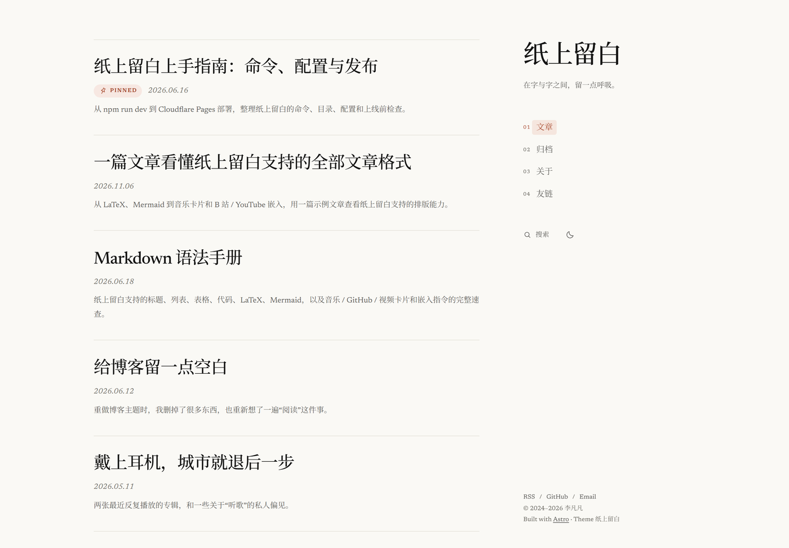
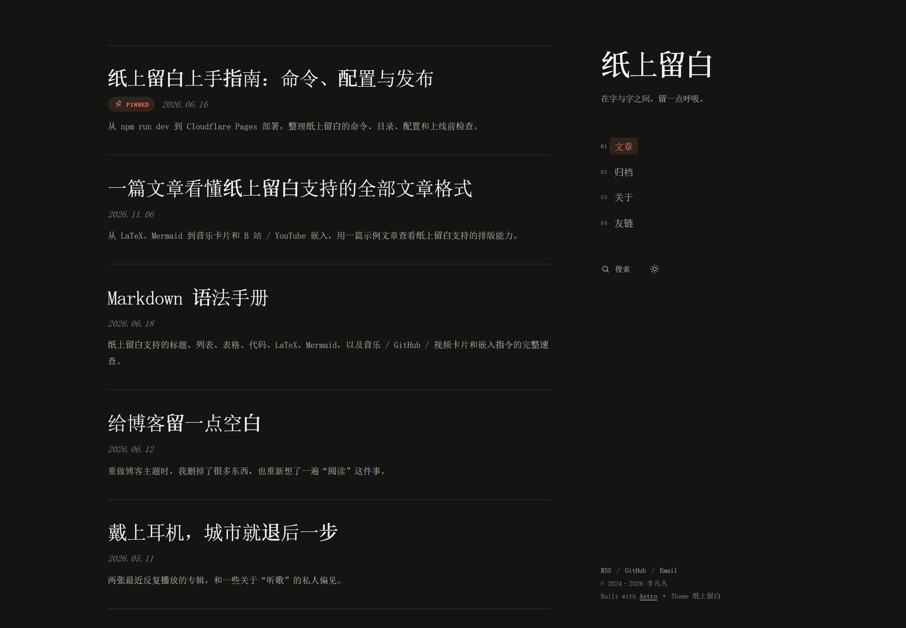
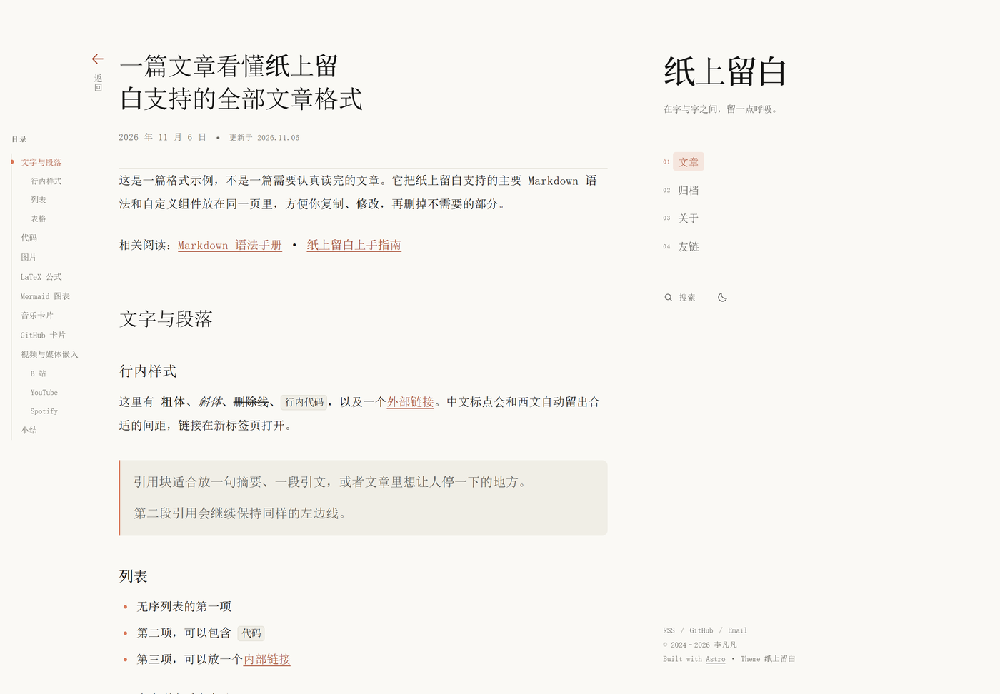
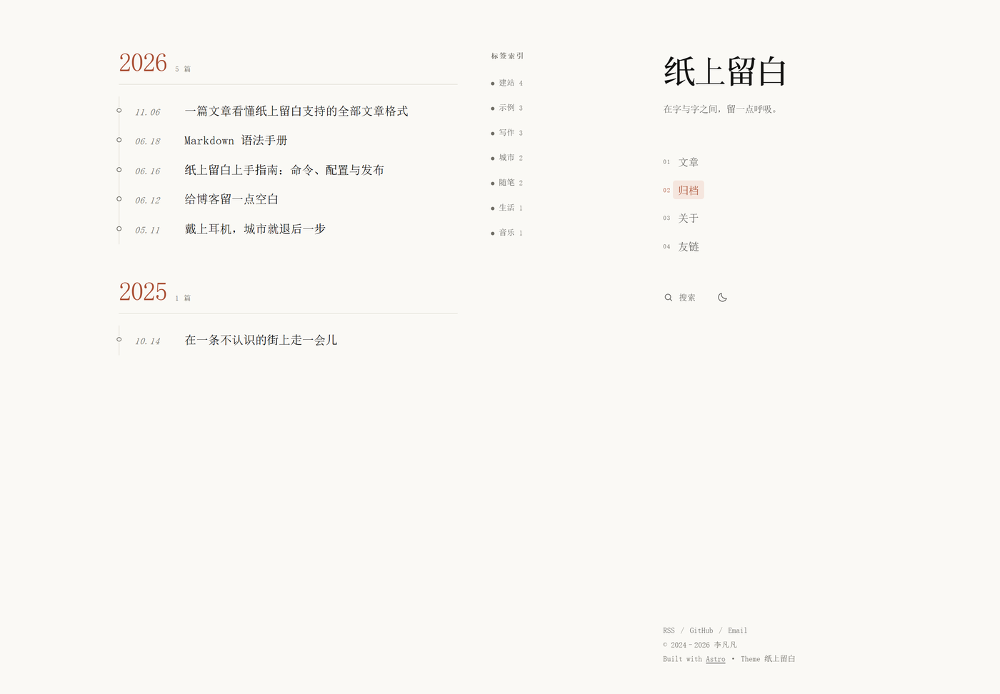
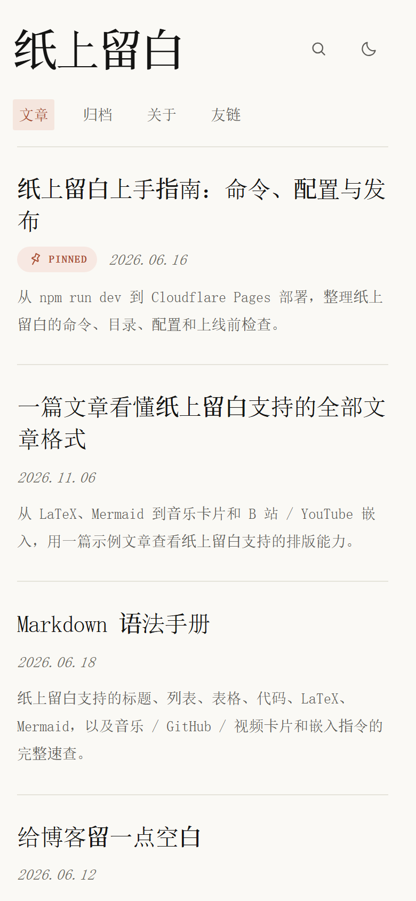
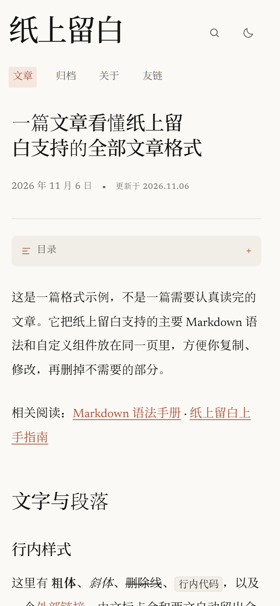
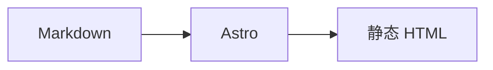

<div align="center">

# 纸上留白 · OnPaper

**在字与字之间，留一点呼吸。**

一个为中文个人博客写的 Astro 主题：正文列 + 右侧窄栏、文章列表、时间线归档。
纯静态输出，零前端框架，几分钟就能部署到 Cloudflare Pages。

[](LICENSE)
[](https://astro.build)
[](https://nodejs.org)
[](https://pages.cloudflare.com)

</div>

---

## 预览

<p align="center">
  
  
  <br />
  
  
  <br />
  
  
</p>

---

## 特性

- **排版优先**：中文正文使用自托管 Noto Serif SC，英文标题使用 Newsreader，代码、数学与图表各用专用字体
- **阅读体验**：文章目录、阅读进度、图片灯箱（滚轮 / 双指缩放、拖动）、回到顶部、分享栏
- **移动端**：文章页顶栏随滚动压缩，给正文让出空间；44px 触控热区
- **搜索**：<kbd>Ctrl</kbd> / <kbd>Cmd</kbd> + <kbd>K</kbd> 或 <kbd>/</kbd> 唤起，构建期生成索引，覆盖标题、标签与正文
- **主题**：浅色 / 深色 / 跟随系统，圆形揭示切换，可持久化
- **Markdown 扩展**：KaTeX 公式、Mermaid 图表、音乐卡片、GitHub 卡片、视频嵌入
- **可选能力**：Google Analytics 4、基于 Cloudflare KV 的阅读计数
- **无障碍**：跳转正文、可见焦点、语义化标题、`aria-current`、可键盘操作的弹窗

---

## 快速开始

需要 Node.js **22.12** 或更高版本。

```bash
npm install
npm run dev
```

打开 <http://127.0.0.1:4321/>。

| 命令 | 说明 |
| --- | --- |
| `npm run dev` | 启动开发服务器 |
| `npm run new -- "标题"` | 新建一篇带 frontmatter 的文章 |
| `npm run build` | 生成静态站点到 `dist/` |
| `npm run build:clean` | 清理 Astro 内容缓存后再构建 |
| `npm run clean` | 只清理 `.astro` / `node_modules/.astro` 缓存 |
| `npm run preview` | 预览生产构建 |
| `npm run shots` | Playwright 截图检查（需要先运行 dev） |
| `npm run og` | 从 `public/og.svg` 重新生成 `public/og.png` |
| `npm run music` | 解析并缓存 `::music` 指令里的链接 |

### 新建文章

`npm run new` 会按当前日期生成 frontmatter，文件名就是 URL slug：

```bash
npm run new -- "在一条不认识的街上走一会儿" --slug a-walk-without-a-map

npm run new -- "标题" --tags 随笔,城市 --pin 1 --draft
```

| 参数 | 说明 |
| --- | --- |
| `--slug` | 文件名 / URL。中文标题无法转换成英文时使用时间戳，建议手动指定 |
| `--tags` | 逗号分隔的标签，例如 `随笔,城市` |
| `--pin` | 置顶权重，数字越大越靠前，默认 `0` |
| `--draft` | 写入 `draft: true`，只在开发环境可见 |

生成的文件在 `src/content/posts/<slug>.md`，之后直接编辑正文即可。

---

## 项目结构

```text
src/
├── config.ts                 站点、导航、配色、字体、功能开关
├── content.config.ts         内容集合 schema
├── content/
│   ├── posts/                文章
│   └── pages/about.md        关于页
├── components/               界面组件
├── layouts/BaseLayout.astro  页面外壳、主题脚本、全局样式
├── pages/                    首页、文章、归档、标签、关于、搜索索引、RSS
├── plugins/                  Markdown 指令、Mermaid、外链、开发期 views
├── styles/                   字体、布局、正文、扩展卡片
└── utils/                    文章查询、格式化、音乐解析

functions/api/views.js        Cloudflare Pages Function
scripts/                      音乐缓存、OG 生成、截图、缓存清理
public/                       favicon、OG、字体、示例图片、_headers
```

---

## 站点配置

所有站点信息集中在 `src/config.ts`：

<details>
<summary><b>展开完整配置示例</b></summary>

```ts
export const siteConfig = {
  title: '纸上留白',
  subtitle: '在字与字之间，留一点呼吸。',
  description: '一个关于随笔、音乐与城市夜色的个人博客。',
  author: '李凡凡',
  email: 'hello@onpaper.example',
  url: 'https://onpaper.example.com', // 部署后改成真实域名
  postsPerPage: 4,
  tocOpen: false, // 文章目录默认收起

  nav: [
    { label: '文章', href: '/' },
    { label: '归档', href: '/tags/' },
    { label: '关于', href: '/about/' },
    { label: '友链', href: '/friends/' },
  ],

  friends: [
    { name: '山茶书房', url: 'https://shanchafang.example/', description: '……' },
  ],

  analytics: {
    googleAnalyticsId: '', // 可选，填写 GA4 的 G-XXXXXXXXXX
  },

  socials: [
    { label: 'RSS', href: '/rss.xml', external: true },
    { label: 'GitHub', href: 'https://github.com/', external: true },
    { label: 'Email', href: 'mailto:hello@onpaper.example' },
  ],

  theme: {
    defaultMode: 'auto', // auto | light | dark
    light: { paper: '#FAF9F5', ink: '#141413', accent: '#D97757' },
    dark: { paper: '#141413', ink: '#FAF9F5', accent: '#D97757' },
  },

  fonts: {
    display: '"Newsreader", "Noto Serif SC Variable", "Songti SC", …',
    body: '"Newsreader", "Noto Serif SC Variable", "Songti SC", …',
    mono: '"SFMono-Regular", Consolas, …',
  },

  features: {
    search: true,
    views: true,
    musicCards: true,
    githubCards: true,
    mediaEmbeds: true,
    math: true,
    mermaid: true,
  },
}
```

</details>

### 改配色

只改 `theme.light` / `theme.dark` 即可，主题会把它们注入成 CSS 变量：

| 变量 | 用途 | 变量 | 用途 |
| --- | --- | --- | --- |
| `paper` | 页面背景 | `ink` | 主文字 |
| `paperRaised` | 卡片 / 代码块表面 | `inkSoft` | 正文 / 次要文字 |
| `surface` | 浅一层的表面 | `inkFaint` | 日期 / 说明文字 |
| `surfaceAlt` | 更深的表面 | `line` | 分隔线 |
| `accent` | 链接、当前导航 | `accentStrong` | 强调文字的深色版 |
| `accentSoft` | 强调的浅底 | `peach` | 辅助暖色 |
| `moss` | 辅助橄榄绿 | | |

默认配色：`#FAF9F5` 纸色、`#141413` 墨色、`#D97757` 赤陶橙、`#788C5D` 橄榄绿。

### 改字体

`siteConfig.fonts` 控制三套字体栈：

- 中文：自托管 **Noto Serif SC Variable**，按 `unicode-range` 分片，浏览器只加载实际用到的字形
- 英文：自托管 **Newsreader**（SIL OFL）
- 代码：等宽字体；数学与 Mermaid 使用各自的专用字体

Noto Serif SC 使用 `font-display: optional`：首次冷加载若子集未就绪，先用系统宋体显示，字体缓存后统一为 Noto，避免字体切换时文字跳动。中文子集首次加载约 1.1–1.4 MB。

### 友链

在 `siteConfig.friends` 增删条目，每项包含 `name`、`url`、`description`。友链页会自动生成，导航入口来自 `siteConfig.nav`。

### 分享图（OG）

`public/og.svg` 是分享卡片模板，`npm run og` 会把它渲染成 `public/og.png`（1200×630）。页面默认用它作为 `og:image` / `twitter:image`。

修改标题、副标题或配色后，先同步 `public/og.svg`，再运行：

```bash
npm run og
```

### Google Analytics 4（可选）

1. 在 [Google Analytics](https://analytics.google.com) 创建媒体资源和 Web 数据流，复制 Measurement ID（`G-XXXXXXXXXX`）
2. 填到 `siteConfig.analytics.googleAnalyticsId`
3. 重新构建并部署

只有生产构建且 ID 非空时才注入 `gtag.js`，`npm run dev` 不会加载。主题关闭了 GA 的自动 page_view，改为在 `astro:page-load` 手动上报，客户端路由切换也能正确统计。留空则完全不加载任何 GA 脚本。

---

## 写文章

推荐用脚手架生成，frontmatter 和日期会自动填好：

```bash
npm run new -- "雨停之前，先别急着走" --slug rain-before-it-stops --tags 随笔,城市
```

也可以直接在 `src/content/posts/` 新建 `.md`，文件名即 URL slug：

```md
---
title: 雨停之前，先别急着走
description: 一句话摘要，会出现在列表和搜索里。
published: 2026-10-28
updated: 2026-10-30        # 可选
tags:
  - 随笔
  - 城市
pin: 1                     # 0 为不置顶，数字越大越靠前
draft: false               # true 时只在 dev 可见
---

正文……
```

关于页在 `src/content/pages/about.md`。首页每页文章数由 `siteConfig.postsPerPage` 控制；置顶文章只出现在第一页，列表里用一个小别针图标标记。

---

## Markdown 扩展

### 音乐卡片

```md
::music{url="https://open.spotify.com/album/2X2WYTQl5BVInM0StQChCy"}
```

构建时：

1. 先读 `src/data/music-cache.json` 缓存
2. 没有缓存时，用 `fetch` 读取 Spotify 元数据
3. 解析专辑 / 单曲名、艺人、类型与封面
4. 到 Apple Music / 网易云 / QQ 音乐搜索，按标题、艺人、类型打分
5. 每个平台取最高分且达到阈值的结果，合并成一张卡片

> [!TIP]
> **推荐从 Spotify 链接开始**，作为起点时跨平台匹配准确率最高。想加音乐，先在 Spotify 找到专辑或歌曲，再粘贴 `::music` 链接。

新增或修改链接后运行 `npm run music`，结果会写回 `src/data/music-cache.json`，建议一起提交，之后构建不再请求平台。

手动填写（需要自己准备封面）：

```md
::music-card{title="城市" artist="张悬" cover="https://.../cover.jpg" type="album" spotify="https://open.spotify.com/album/..."}
```

### GitHub 卡片

支持直接粘贴仓库网址，或写 `owner/name`：

```md
::github{url="https://github.com/withastro/astro"}

::github{repo="withastro/astro" description="The web framework for content-driven websites." stars="52k" forks="2.8k" language="TypeScript"}
```

`url` 形式会在构建时解析出 owner / repo。卡片在浏览器里按需读取 GitHub 公开 API，并用 `sessionStorage` 缓存；没有网络时保留静态字段。

### 媒体嵌入

```md
::embed{url="https://open.spotify.com/album/2X2WYTQl5BVInM0StQChCy" title="张悬《城市》" caption="有时候，一张专辑就够陪一个晚上。"}
```

支持 YouTube、Bilibili、Spotify、Vimeo。iframe 使用 `loading="lazy"`，进入视口后自动加载，**不会自动播放**（B 站额外设置 `autoplay=0`、`poster=1` 并禁用 autoplay 权限）。

### 数学与图表

行内数学 `$T = \frac{C}{400}$`，块级数学：

```md
$$
\text{留白} = \text{内容} - \text{噪音}
$$
```

Mermaid：

````md

````

Mermaid 只在页面出现图表时动态加载；KaTeX 的 CSS 也只在文章包含数学时引入。

> [!NOTE]
> 修改 Markdown 插件后，先停止开发服务，运行 `npm run clean`，再重新 `npm run dev`，避免 Astro 继续使用旧的内容缓存。

---

## 部署到 Cloudflare Pages

站点是纯静态的，只有阅读计数通过一个 Pages Function 访问 KV。

在 Cloudflare Pages 里设置：

| 配置项 | 值 |
| --- | --- |
| Build command | `npm run build` |
| Build output directory | `dist` |
| Node version | 22.12+ |

或者本地构建后用 Wrangler 上传：

```bash
npm run build
npx wrangler pages deploy dist
```

### 绑定 KV（可选，用于阅读计数）

1. 进入 **Workers & Pages → KV**，创建命名空间，例如 `onpaper-views`
2. 进入 Pages 项目 → **Settings → Functions → KV namespace bindings**
3. 变量名填 **`VIEWS_KV`**，选择刚创建的命名空间
4. 重新部署

也可以使用 Wrangler：

```bash
npx wrangler kv namespace create VIEWS_KV
```

把返回的 id 填进 `wrangler.toml` 里被注释掉的 `[[kv_namespaces]]` 块并取消注释。

接口：

| 方法 | 路径 | 说明 |
| --- | --- | --- |
| `GET` | `/api/views?slug=post-id` | 返回 `{ "views": 12 }` |
| `POST` | `/api/views?slug=post-id` | 计数 +1，返回新值 |

slug 只接受小写字母、数字和连字符，最长 96 字符。KV 未绑定时返回 503，文章页会自动隐藏计数，不影响阅读。

`npm run dev` 使用内存里的同名接口做演示，重启后计数归零。

---

## 设计说明

- **布局**：正文列 + 右侧固定窄栏（刊头、导航、搜索、主题、页脚）；移动端折叠为顶部导航和单列列表
- **刊头**：只保留大号「纸上留白」和副标题，去掉卷号与英文小字
- **首页**：文章列表 + 分页，不做营销式 hero；列表标题、描述和分隔线与内容列同宽
- **文章页**：宽屏桌面左侧固定层级目录，窄屏回退顶部目录面板；宽屏标题左侧固定「← 首页」，较窄宽度放在标题上方
- **归档**：按年份分组的纵向时间线 + 标签索引
- **颜色**：平涂背景，没有渐变和装饰光效
- **动效**：页面过渡、滚动渐入、主题圆形揭示；优先使用透明度与 transform，全部尊重 `prefers-reduced-motion`
- **图标**：全部为内联 SVG 或 CSS 形状

---

## 灵感

版式上受到这两个 Astro 主题的启发，推荐一并看看：

- [astro-theme-retypeset](https://github.com/radishzzz/astro-theme-retypeset)
- [astro-theme-typography](https://github.com/moeyua/astro-theme-typography)

---

## 许可

[MIT](LICENSE) · 字体 Newsreader 与 Noto Serif SC 使用 SIL Open Font License 1.1，见 `public/fonts/` 下的授权文件。
