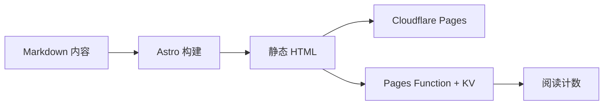

做这个主题的时候，我给自己定了一个很简单的目标：让文章看起来像文章，而不是像一张塞满按钮的卡片。

于是删掉了很多东西。评论、访问统计以外的分析脚本、用不到的短代码、那些“看起来很厉害但从来没点过”的功能。留下来的东西不多：标题、正文、目录、标签、一点必要的互动，以及足够的空白。

文章是有阅读成本的。既然有成本，就不应该让读者在进入正文之前，先穿过一堆无关的东西。

## 页面是怎么长出来的

整个站点是纯静态的。Cloudflare Pages 负责托管 `dist/`，只有阅读计数走一个轻量的 Pages Function。没有数据库，没有常驻服务器，也没有为了一个数字引入一整套后端。

## 留白的公式

$$
\text{余白} = \text{内容} - \text{噪音}
$$

这个公式当然不严谨，但它很接近我对“好读”的理解。余白不是空，而是让内容有地方站直。

::github{repo="withastro/astro" description="The web framework for content-driven websites." stars="52k" forks="2.8k" language="TypeScript"}

## 一点技术上的私心

我喜欢静态站点，因为它足够诚实。你写下的东西，最后会变成一个个 HTML 文件，放在那里，不依赖某个服务今天心情好不好。

::embed{url="https://open.spotify.com/album/6fbvyqPZVxVPk5DBm4krJf" title="陈粒《十年自选》" caption="写主题的时候，循环最多的专辑之一。"}

当然，静态也有静态的麻烦。搜索索引要在构建时生成，阅读计数要借助边缘函数，更新文章要重新部署。但这些麻烦是可见的、可理解的，不像某些黑盒一样，出了问题只能等。

## 最后

这个主题叫“余白”。它不打算讨好所有人，也不想把所有功能都塞进一个页面。它只是想给写字的人一点安静，给读字的人一点呼吸。

如果你也刚好喜欢，那就很好。