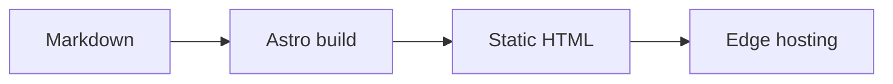

This is a formatting sample, not an article to read closely. It puts the main Markdown syntax and the theme's own components on one page, so you can copy what you need and delete the rest.

Related: [the Markdown guide](/posts/markdown-guide/) · [getting started](/posts/getting-started/)

The outline on the right highlights the section you are in; on a narrow screen it folds above the text.

## Text and paragraphs

### Inline styles

Here is **bold**, *italic*, ~~strikethrough~~, `inline code`, and an [external link](https://astro.build/). Links open in a new tab, and CJK punctuation gets its proper spacing against Latin text.

In Chinese, italics render as 着重号 — emphasis dots under the characters — because that is how a Chinese book marks emphasis. Superscript and subscript use raw HTML: H<sub>2</sub>O, E=mc<sup>2</sup>.

> A blockquote suits a summary, a quotation, or a place where the article wants the reader to stop for a moment.
>
> A second paragraph keeps the same rule down the left edge.

### Lists

- First item
- Second item
  - Nested item
  - Another nested item
- Third item

1. Step one
2. Step two
3. Step three

- [x] A finished task
- [ ] An unfinished task

### A table

| Syntax | Component | Notes |
| :----- | :-------: | ----: |
| Music | `::music{...}` | Detects the platform |
| GitHub | `::github{...}` | Reads the API on demand |
| Video | `::embed{...}` | Lazy iframe, loads in view |

## Code

```js
export function greet(name) {
  const message = `Hello, ${name}`
  console.log(message)
  return message
}
```

```python
def fib(n: int) -> int:
    a, b = 0, 1
    for _ in range(n):
        a, b = b, a + b
    return a
```

Inline code sits in running text like `const answer = 42`, and a long address such as `https://api.example.com/v1/completions` breaks rather than running past the column.

## Images

Images are lazy-loaded, and clicking one opens it at full size: scroll to zoom, drag to pan, double-click to reset.

## LaTeX

Inline: $E = mc^2$ and $\int_0^1 x^2\,dx = \tfrac{1}{3}$.

A display equation:

$$
\nabla \cdot \mathbf{E} = \frac{\rho}{\varepsilon_0}
$$

## Mermaid

This diagram is drawn in the browser; switching between light and dark redraws it in the current theme.



## Music card

`::music` reads the build-time cache, recognises Spotify, Apple Music, NetEase and QQ Music, and matches the record across the others. Starting from a Spotify link gives the best match rate; the full parameters are in the [Markdown guide](/posts/markdown-guide/#音乐卡片).

::music{url="https://open.spotify.com/album/2X2WYTQl5BVInM0StQChCy"}

## GitHub card

`::github` takes a repository URL or `repo="owner/name"`. The static fields below are rendered at build time; the card refreshes them from the public API when it loads.

::github{url="https://github.com/withastro/astro" description="The web framework for content-driven websites." stars="52k" forks="2.8k" language="TypeScript"}

## Video and media

`::embed` turns a link into a lazy iframe that loads when it scrolls into view — nothing is requested until then.

::embed{url="https://www.youtube.com/watch?v=J28oOfvNVD8" title="YouTube example" caption="Served from youtube-nocookie.com, loaded when it reaches the viewport."}

## Raw HTML

A post can write HTML directly. Inline styles are allowed for typography — a colour, an alignment — and everything else is filtered:

<p style="text-align:center">This paragraph is centred with an inline style.</p>

<span style="color:#c0392b;font-weight:bold">Red text, set with an inline style.</span>

## Wrapping up

Copy a section, change the words, delete the rest. Everything above is ordinary Markdown except the four `::` components, which are documented in the [Markdown guide](/posts/markdown-guide/).
