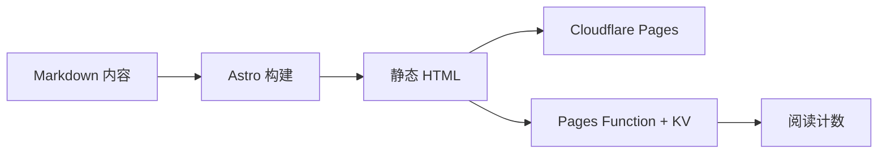

这是一篇格式示例，不是一篇需要认真读完的文章。它把余白支持的主要 Markdown 语法和自定义组件放在同一页里，方便你复制、修改，再删掉不需要的部分。

相关阅读：[Markdown 语法手册](/posts/markdown-guide/) · [余白上手指南](/posts/getting-started/)

## 文字与段落

### 行内样式

这里有 **粗体**、*斜体*、~~删除线~~、`行内代码`，以及一个[外部链接](https://astro.build/)。中文标点会和西文自动留出合适的间距，链接在新标签页打开。

> 引用块适合放一句摘要、一段引文，或者文章里想让人停一下的地方。
>
> 第二段引用会继续保持同样的左边线。

### 列表

- 无序列表的第一项
- 第二项，可以包含 `代码`
- 第三项，可以放一个[内部链接](/friends/)

1. 有序列表适合步骤
2. 第二步
3. 第三步

- [x] 已完成的任务
- [ ] 待完成的任务

### 表格

| 能力 | 写法 | 说明 |
| --- | --- | --- |
| 行内公式 | `$E = mc^2$` | 由 KaTeX 渲染 |
| 独立公式 | `$$ ... $$` | 居中显示，可滚动 |
| 图表 | Mermaid 代码块 | 深浅色主题自动重绘 |
| 音乐 | `::music{...}` | 自动识别平台 |
| 视频 | `::embed{...}` | 点击后才加载播放器 |

## 代码

代码块会带语言标签和复制按钮。下面是一段普通的 JavaScript：

```js
const posts = await getCollection('posts')
const latest = posts
  .filter(post => !post.data.draft)
  .sort((a, b) => b.data.published - a.data.published)

console.log(latest[0]?.data.title)
```

行内代码写作 `` `const` ``，长命令可以放在多行代码块里：

```bash
npm run dev
npm run build:clean
npm run preview
```

## 图片

正文图片点击后会打开灯箱，支持滚轮 / 双指缩放、拖动和键盘操作。


*图片说明可以放在图片下方，也可以直接写在 alt 里；灯箱会用 alt 作为说明。*

## LaTeX 公式

行内公式适合嵌在句子里，例如质能方程 $E = mc^2$，或者一个简单的阅读时间估算 $T = \frac{C}{400}$。

独立公式会单独占一行：

$$
\text{余白} = \text{内容} - \text{噪音}
$$

公式块支持横向滚动，不会把正文撑出屏幕。

## Mermaid 图表

下面这张流程图会在浏览器里渲染；切换深浅色主题时，它会按当前主题重新绘制。



图表使用 Mermaid 的严格安全模式，只渲染受支持的图表语法。

## 音乐卡片

`::music` 会读取构建期缓存，识别 Spotify、Apple Music、网易云和 QQ 音乐，并自动匹配其他平台的链接。

::music{url="https://open.spotify.com/album/2X2WYTQl5BVInM0StQChCy"}

## GitHub 卡片

`::github` 会在卡片接近视口时读取一次 GitHub 公开 API；没有网络时保留静态字段。

::github{repo="withastro/astro" description="The web framework for content-driven websites." stars="52k" forks="2.8k" language="TypeScript"}

## 视频与媒体嵌入

视频默认只显示一张海报，不会在页面加载时请求第三方播放器。点击后才创建 iframe。

### B 站

::embed{url="https://www.bilibili.com/video/BV1xx411c7mD" title="B 站视频示例" caption="点击封面后才会加载 B 站播放器。"}

### YouTube

::embed{url="https://www.youtube.com/watch?v=aqz-KE-bpKQ" title="YouTube 视频示例" caption="YouTube 使用 youtube-nocookie.com，点击后才创建 iframe。"}

### Spotify

::embed{url="https://open.spotify.com/album/6fbvyqPZVxVPk5DBm4krJf" title="Spotify 专辑示例" caption="同样的点击后加载策略。"}

## 小结

以上是余白目前支持的主要格式。写作时不必全部用上：一篇文章通常只需要标题、正文、目录和少量图片；音乐、图表和嵌入留给真正需要它们的段落。

如果你要复制某一段语法，可以回到 [Markdown 语法手册](/posts/markdown-guide/)；如果要修改站点配置或部署，请看[余白上手指南](/posts/getting-started/)。