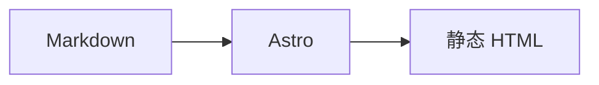

这篇手册只列余白实际支持的写法。想看渲染后的效果，请打开[格式示例](/posts/format-showcase/)；想了解命令和部署，请看[上手指南](/posts/getting-started/)。

## Frontmatter

文章放在 `src/content/posts/`，开头用 YAML 描述元数据：

```yaml
---
title: 文章标题
description: 一句话摘要，会出现在列表、搜索和 SEO 里
published: 2026-11-06
updated: 2026-11-08        # 可选
tags:
  - 随笔
  - 城市
pin: 0                     # 0 为不置顶，数字越大越靠前
draft: false               # true 时只在开发环境可见
---
```

`title` 必填；其余字段有默认值。日期使用 `YYYY-MM-DD`。

## 标题与目录

使用 `#` 到 `######` 表示标题。文章正文一般从 `##` 开始：

```md
## 一级章节

### 二级章节
```

`##` 和 `###` 会进入文章目录；目录在宽屏桌面固定显示，窄屏和移动端折叠在正文上方。

## 行内样式

```md
**粗体**、*斜体*、~~删除线~~、`行内代码`
```

中文和西文之间的空格会自动处理，不需要手动敲空格。

## 链接与图片

```md
[外部链接](https://astro.build/)
[站内链接](/posts/format-showcase/)

```

外部链接会自动加上 `target="_blank"` 和 `rel="noopener noreferrer"`。正文图片自动支持点击放大，灯箱说明使用图片的 alt 文本。

## 列表

```md
- 无序列表
- 第二项

1. 有序列表
2. 第二项

- [x] 已完成
- [ ] 待完成
```

任务列表、表格、删除线使用 GitHub Flavored Markdown 语法。

## 表格

```md
| 列一 | 列二 |
| --- | --- |
| 内容 | 内容 |
```

表格在窄屏会横向滚动，不会把正文撑宽。

## 引用与分隔线

```md
> 一段引用。

---
```

## 代码

行内代码用反引号；块级代码指定语言后会有语言标签和复制按钮：

````md
```js
const posts = await getCollection('posts')
```
````

支持的常用语言包括 `js`、`ts`、`html`、`css`、`bash`、`json`、`yaml`、`md` 等。代码块不会被首页摘要或搜索索引当成正文。

## LaTeX 公式

行内公式：

```md
$E = mc^2$
```

独立公式：

```md
$$
\text{余白} = \text{内容} - \text{噪音}
$$
```

KaTeX 的 CSS 只在文章包含公式时加载；公式不会开启 `trust`，不执行危险命令。

## Mermaid 图表

使用 `mermaid` 代码块：

````md

````

图表在浏览器里按当前明暗主题渲染；Mermaid 使用 `securityLevel: 'strict'`，并且只渲染已经支持的图表语法。

## 自定义指令

### 音乐

自动识别平台（推荐）：

```md
::music{url="https://open.spotify.com/album/2X2WYTQl5BVInM0StQChCy"}
```

支持 Spotify、Apple Music、网易云、QQ 音乐。**推荐从 Spotify 链接开始**：构建期会读取 Spotify 元数据，解析专辑/歌曲、艺人和类型，再到其他平台搜索并按标题、艺人、类型打分，合并最高分结果。

新增链接后运行：

```bash
npm run music
```

解析结果会写入 `src/data/music-cache.json`，建议一起提交，之后构建不再请求平台。

手动填写：

```md
::music-card{title="城市" artist="张悬" cover="https://example.com/cover.jpg" type="album" spotify="https://open.spotify.com/album/..."}
```

### GitHub 卡片

```md
::github{repo="withastro/astro" description="The web framework for content-driven websites." stars="52k" forks="2.8k" language="TypeScript"}
```

卡片在文章加载时请求 GitHub 公开 API；没有网络时保留静态字段。

### 视频与媒体

```md
::embed{url="https://www.youtube.com/watch?v=..." title="YouTube 视频"}
::embed{url="https://www.bilibili.com/video/BV..." title="B 站视频"}
::embed{url="https://open.spotify.com/album/..." title="Spotify 专辑"}
::embed{url="https://vimeo.com/..." title="Vimeo 视频"}
```

支持 YouTube、B 站、Spotify、Vimeo。输出 `loading="lazy"` 的 iframe，进入视口后自动加载，不自动播放。

## 原始 HTML

Markdown 里可以直接写 HTML，例如带说明的图片：

```html
<figure>
  
  <figcaption>图片说明</figcaption>
</figure>
```

**原始 HTML 被视为作者可信内容。** 不要直接合并不受信任的投稿；如果以后开放多人投稿，需要先加 sanitizer 或禁止 raw HTML。

## 发布检查

- 标题、摘要、日期、标签是否完整；
- 是否误用了未来日期或 `draft: true`；
- 图片是否有 alt 和尺寸；
- 新增 `::music` 后是否运行了 `npm run music`；
- 修改插件或指令后是否用了 `npm run build:clean`。

更多命令和配置见[余白上手指南](/posts/getting-started/)。