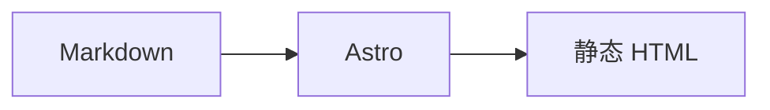

这篇手册只列纸上留白实际支持的写法，可以直接复制使用。想看渲染后的效果，请打开[格式示例](/posts/format-showcase/)；想了解命令、配置和部署，请看[上手指南](/posts/getting-started/)。

## Frontmatter

文章放在 `src/content/posts/`，开头用 YAML 描述元数据：

```yaml
---
title: 文章标题
description: 一句话摘要，会出现在列表、搜索和 SEO 里
published: 2026-11-06
updated: 2026-11-08        # 可选
tags:
  - 随笔
  - 城市
pin: 0                     # 0 为不置顶，数字越大越靠前
draft: false               # true 时只在开发环境可见
---
```

| 字段 | 必填 | 说明 |
| --- | --- | --- |
| `title` | 是 | 文章标题 |
| `description` | 否 | 摘要；留空时自动截取正文前 88 字 |
| `published` | 是 | 发布日期，`YYYY-MM-DD` |
| `updated` | 否 | 更新日期，文章头部显示“更新于” |
| `tags` | 否 | 标签数组，会生成标签页和归档 |
| `pin` | 否 | 置顶权重，`0` 为不置顶 |
| `draft` | 否 | `true` 时仅开发环境可见，构建时排除 |

文件名就是 URL slug，例如 `a-little-margin.md` → `/posts/a-little-margin/`。

## 标题与目录

使用 `#` 到 `######` 表示标题。文章正文从 `##` 开始：

```md
## 一级章节

### 二级章节
```

`##` 和 `###` 会进入文章目录：宽屏桌面固定在左侧，窄屏和移动端折叠在正文上方。

## 行内样式

```md
**粗体**、*斜体*、~~删除线~~、`行内代码`、H~2~O
```

中文和西文之间的空格会自动处理，不需要手动敲空格。

## 链接与图片

```md
[外部链接](https://astro.build/)
[站内链接](/posts/format-showcase/)

```

- 外部链接自动加 `target="_blank"` 和 `rel="noopener noreferrer"`。
- 正文图片自动 `loading="lazy"`、可点击放大，灯箱说明使用 alt 文本。
- 图片建议写完整路径，放在 `public/images/` 或使用图床 HTTPS 地址。

带说明的图片可以用原始 HTML：

```html
<figure>
  
  <figcaption>图片说明会显示在图片下方。</figcaption>
</figure>
```

## 列表

```md
- 无序列表
- 第二项

1. 有序列表
2. 第二项

- [x] 已完成
- [ ] 待完成
```

任务列表的复选框会自动补上无障碍标签。

## 表格

```md
| 列一 | 列二 |
| --- | --- |
| 内容 | 内容 |
```

表格在窄屏会横向滚动，不会把正文撑宽。

## 引用与分隔线

```md
> 一段引用。

---
```

## 代码

行内代码用反引号；块级代码指定语言后会有语言标签和复制按钮：

````md
```js
const posts = await getCollection('posts')
```
````

常用语言：`js`、`ts`、`jsx`、`html`、`css`、`bash`、`json`、`yaml`、`md`、`python`。代码块不会被首页摘要或搜索索引当成正文。

## LaTeX 公式

行内公式：

```md
$E = mc^2$
```

独立公式：

```md
$$
\text{留白} = \text{内容} - \text{噪音}
$$
```

KaTeX 的 CSS 只在文章真正包含公式时加载；代码块里的 `$...$` 只是示例，不会触发渲染。

## Mermaid 图表

使用 `mermaid` 代码块：

````md

````

图表在浏览器里按当前明暗主题渲染，使用 `securityLevel: 'strict'`，只在支持范围内渲染。

## 音乐卡片

纸上留白有两种写法。**推荐用自动解析**，因为构建期会做跨平台匹配。

> 所有 `::指令` 的属性都要写在**同一行**里；这里为了可读性会折行显示，但真实文件里请保持单行。

### 自动解析（推荐）

```md
::music{url="https://open.spotify.com/album/2X2WYTQl5BVInM0StQChCy"}
```

只接受 Spotify、Apple Music、网易云、QQ 音乐的链接；其他地址会显示一条提示。

构建时它会：

1. 先查 `src/data/music-cache.json` 缓存；
2. 没有缓存时，构建期 `fetch` 读取 Spotify 页面 / oEmbed 元数据；
3. 解析出专辑或单曲名称、艺人、类型、封面；
4. 用「标题 + 艺人」到 Apple Music、网易云、QQ 音乐搜索；
5. 对每个结果按标题、艺人、类型打分，取每个平台分数最高且达到阈值的结果；
6. 合并成一张包含多个平台链接的卡片。

**所以想加音乐时，推荐先去 Spotify 找到专辑或歌曲，再复制链接。** 从 Spotify 开始识别准确率最高。冷门版本匹配不准时，可以用下面的手动写法固定字段。

新增或修改 `::music` 后运行：

```bash
npm run music
```

解析结果会写入 `src/data/music-cache.json`，建议一起提交，之后构建不再请求平台。

### 手动填写

```md
::music-card{title="城市" artist="张悬" type="album" cover="https://example.com/cover.jpg" spotify="https://open.spotify.com/album/..." apple="https://music.apple.com/..." netease="https://music.163.com/#/album?id=..." qq="https://y.qq.com/n/ryqq/albumDetail/..." lyric="可选的一句歌词"}
```

| 参数 | 必填 | 说明 |
| --- | --- | --- |
| `title` | 是 | 专辑 / 歌曲名 |
| `artist` | 是 | 艺人 |
| `type` | 否 | `album` 或 `single`，默认 `single` |
| `cover` | 否 | HTTPS 封面地址 |
| `spotify` / `apple` / `netease` / `qq` | 否 | 对应平台链接，缺省不显示该按钮 |
| `lyric` | 否 | 可选的一句歌词 |

## GitHub 卡片

两种写法等价，**也可以直接粘贴仓库网址**：

```md
::github{repo="withastro/astro"}

::github{url="https://github.com/withastro/astro"}
```

```md
::github{repo="withastro/astro" description="The web framework for content-driven websites." stars="52k" forks="2.8k" language="TypeScript"}
```

| 参数 | 必填 | 说明 |
| --- | --- | --- |
| `repo` | 二选一 | `owner/name` |
| `url` | 二选一 | `https://github.com/owner/name`，会解析出 repo |
| `description` | 否 | 备用描述；API 返回后会被真实描述替换 |
| `stars` / `forks` / `language` | 否 | 备用静态值，API 失败时显示 |

文章加载时会请求一次 GitHub 公开 API 补全描述、Star、Fork 和语言；没有网络或超出 API 限制时保留你写的静态字段，卡片依然可点击。

## 视频与媒体嵌入

```md
::embed{url="https://www.youtube.com/watch?v=..." title="YouTube 视频"}
::embed{url="https://www.bilibili.com/video/BV..." title="B 站视频"}
::embed{url="https://open.spotify.com/album/..." title="Spotify 专辑"}
::embed{url="https://vimeo.com/..." title="Vimeo 视频"}
```

支持 YouTube、B 站、Spotify、Vimeo。

| 参数 | 必填 | 说明 |
| --- | --- | --- |
| `url` | 是 | 上面四个平台之一的链接 |
| `title` | 否 | iframe 的标题，也用于无障碍标签 |
| `caption` | 否 | 卡片下方的说明文字 |

行为说明：

- 输出 `loading="lazy"` 的 iframe，进入视口后自动加载；
- **不会自动播放**（B 站显式 `autoplay=0`，YouTube / Vimeo 不带 autoplay）；
- 不支持的链接会降级成一个普通外链卡片，而不是空白框。

## 原始 HTML

Markdown 里可以直接写 HTML，用于图注、表格等 Markdown 不方便表达的排版。

**原始 HTML 被视为作者可信内容。** 不要直接合并不受信任的投稿；如果以后开放多人投稿，需要先加 sanitizer 或禁止 raw HTML。

## 发布检查

- 标题、摘要、日期、标签是否完整；
- 是否误用了未来日期或 `draft: true`；
- 图片是否有 alt 和尺寸；
- 新增 `::music` 后是否运行了 `npm run music`；
- 修改插件或指令后是否用了 `npm run build:clean`。

更多命令和配置见[纸上留白上手指南](/posts/getting-started/)。
